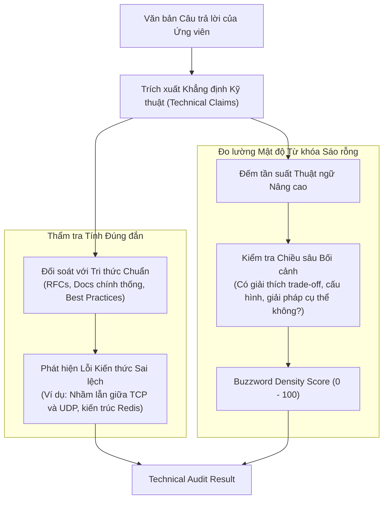

# TASK 3.2: KIỂM CHỨNG KỸ THUẬT & CHỐNG CHÉM GIÓ BUZZWORD (ANTI-FLUFF ENGINE)

> **Trạng thái**: Approved / Production Specification  
> **Cấp độ**: Deep Technical Specification (Fact-Checking & Engineering Verification)  
> **Áp dụng cho**: `ai-service/app/services/assessment/fact_checker.py`  
> **Tài liệu cha**: [00_PHASE_3_OVERVIEW_AND_ARCHITECTURE.md](00_PHASE_3_OVERVIEW_AND_ARCHITECTURE.md)  
> **Phiên bản**: 1.0.0  

---

## 1. MỤC TIÊU KỸ THUẬT

Một vấn đề phổ biến trong phỏng vấn tuyển dụng IT là hiện tượng **"Chém gió thuật ngữ" (Buzzword Dropping)**: Ứng viên tuôn ra hàng loạt từ khóa thời thượng (*Microservices, Event-Driven, Kubernetes, Kafka, Zero-Downtime, Clean Architecture, Sharding*) nhưng:
1. Đưa ra tuyên bố kỹ thuật sai sự thật (Factually Incorrect).
2. Không hiểu nguyên lý vận hành hoặc trade-offs đằng sau công nghệ.
3. Học thuộc lòng các câu trả lời do AI sinh ra (AI-generated boilerplate).

Nhiệm vụ của module này là thực hiện **Kiểm chứng Kỹ thuật Chuyên sâu** độc lập với quá trình chấm điểm câu chữ.

---

## 2. NGUYÊN LÝ KIỂM CHỨNG KỸ THUẬT (FACT-CHECKING METHODOLOGY)



---

## 3. CÔNG THỨC ĐO LƯỜNG MẬT ĐỘ BUZZWORD (`buzzwordDensityScore`)

Điểm mật độ Buzzword được chuẩn hóa trên thang điểm $0 - 100$:

$$\text{BuzzwordDensityScore} = \min\left(100, \text{round}\left(\frac{\text{Số thuật ngữ công nghệ nhắc đến}}{\max(1, \text{Số chi tiết triển khai cụ thể})} \times 25\right)\right)$$

* **$0 - 30$ (Xuất sắc / Thực chiến)**: Ứng viên chỉ nhắc đến công nghệ khi giải thích cặn kẽ cách triển khai và giải pháp cụ thể.
* **$31 - 65$ (Trung bình)**: Có nhắc từ khóa nhưng đôi chỗ còn mang tính lý thuyết sách giáo khoa.
* **$66 - 100$ (Báo động Đỏ - Pure Buzzwords)**: Ứng viên rải từ khóa dày đặc nhưng không đưa ra được bất kỳ chi tiết cấu hình, tham số, mã nguồn hay đánh đổi kiến trúc nào.

---

## 4. PYDANTIC SCHEMA & HỢP ĐỒNG ĐẦU RA

```python
from typing import List
from pydantic import Field
from app.schemas.base import CamelModel

class TechnicalClaimAuditItem(CamelModel):
    claimText: str = Field(description="Khẳng định kỹ thuật cụ thể của ứng viên")
    isAccurate: bool
    explanation: str = Field(description="Phân tích tại sao đúng hoặc sai lệch so với nguyên lý kỹ thuật")

class TechnicalAuditResult(CamelModel):
    isFactuallySound: bool = Field(description="Toàn bộ câu trả lời có tính đúng đắn kỹ thuật không")
    hallucinationFlags: List[str] = Field(default_factory=list, description="Danh sách các lỗi kiến thức sai lệch nghiêm trọng")
    buzzwordDensityScore: int = Field(ge=0, le=100, description="100 = chém gió từ khóa không có chiều sâu")
    auditedClaims: List[TechnicalClaimAuditItem]
```

---

## 5. TIÊU CHÍ NGHIỆM THU (QUALITY GATES)

1. **Khả năng Bắt lỗi Kiến thức Cố ý**: Trong bộ test kiểm thử chứa 10 câu trả lời có cài cắm lỗi kỹ thuật kinh điển (như *"Redis ghi dữ liệu lên ổ đĩa mỗi microsecond"* hoặc *"HTTP/2 chỉ truyền tải văn bản dạng plain text"*), hệ thống phải phát hiện thành công $100\%$ các lỗi này vào `hallucinationFlags`.
2. **Không Đánh oan Ứng viên Thực chiến**: Một câu trả lời ngắn gọn, chính xác, có số liệu đo lường cụ thể không được có điểm `buzzwordDensityScore > 35`.
