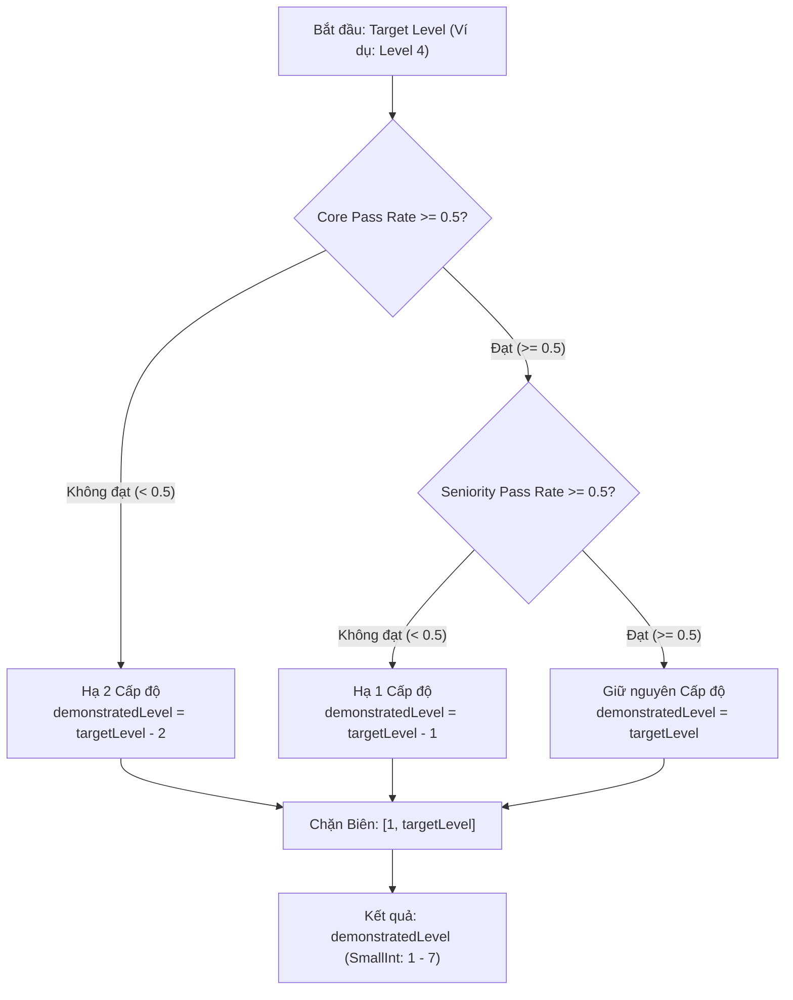

# TASK 3.2: TÍNH ĐIỂM TẤT ĐỊNH & SUY LUẬN CẤP ĐỘ NĂNG LỰC SFIA 9
# (ALREADY IMPLEMENTED IN CODEBASE — VERIFICATION & CONTRACT PRESERVATION)

> **Trạng thái**: **ĐÃ TRIỂN KHAI HOÀN CHỈNH TRONG MÃ NGUỒN (ALREADY IMPLEMENTED)**  
> **Cấp độ**: Deep Technical Specification (Scoring Algorithm & Competency Science)  
> **Vị trí trong mã nguồn**: [`server/src/modules/interview-assessment/evaluation/scoring-engine.service.ts`](file:///c:/Users/An/Documents/GR1/InterviewCoach/server/src/modules/interview-assessment/evaluation/scoring-engine.service.ts)  
> **Bộ Unit Test kiểm thử**: [`server/src/modules/interview-assessment/evaluation/scoring-engine.service.spec.ts`](file:///c:/Users/An/Documents/GR1/InterviewCoach/server/src/modules/interview-assessment/evaluation/scoring-engine.service.spec.ts)  
> **Tài liệu cha**: [00_PHASE_3_OVERVIEW_AND_ARCHITECTURE.md](00_PHASE_3_OVERVIEW_AND_ARCHITECTURE.md)  
> **Phiên bản**: 2.0.0 (Ghi nhận trạng thái hoàn thành và đặc tả bảo vệ hợp đồng toán học)  

---

## 1. NGUYÊN TẮC THIẾT KẾ: TẠI SAO PHẢI TÍNH ĐIỂM TẤT ĐỊNH 100%?

Trong các hệ thống đánh giá phỏng vấn truyền thống, việc yêu cầu LLM "cho một con số điểm từ 0 đến 100" gây ra các vấn đề nghiêm trọng:
1. **Lạm phát Điểm số (Grade Inflation)**: LLM có xu hướng "dĩ hòa vi quý", thường cho điểm từ $70 - 85$ kể cả khi câu trả lời thiếu sót nhiều kiến thức.
2. **Tính Ngẫu nhiên (Stochastic Inconsistency)**: Cùng một câu trả lời, nếu submit 2 lần với LLM có thể cho ra 65 điểm rồi 82 điểm, vi phạm tiêu chuẩn công bằng học thuật và tuyển dụng.

**Giải pháp của InterviewCoach**:
* AI chỉ đóng vai trò **Trọng tài Thẩm định Bằng chứng** (chỉ trả lời Đúng/Sai nhị phân `passed: true | false` cho từng tiêu chí và trích dẫn `evidence`).
* **NestJS [`ScoringEngineService`](file:///c:/Users/An/Documents/GR1/InterviewCoach/server/src/modules/interview-assessment/evaluation/scoring-engine.service.ts)** chịu trách nhiệm độc quyền tính toán toàn bộ điểm số, tỷ lệ đạt và cấp bậc SFIA thông qua **công thức toán học tất định 100%**.

---

## 2. CÔNG THỨC TOÁN HỌC ĐÃ TRIỂN KHAI TRONG MÃ NGUỒN

### 2.1 Tính điểm câu hỏi (`calculateQuestionScore`)
Mỗi câu hỏi có danh sách tiêu chí $C = \{c_1, c_2, \dots, c_n\}$, mỗi tiêu chí có trọng số $w_i \ge 0$ và trạng thái đạt $p_i \in \{0, 1\}$:

$$\text{CriteriaPassRate} = \frac{\sum_{i=1}^n (w_i \times p_i)}{\sum_{i=1}^n w_i} \times 100$$

$$\text{QuestionScore} = \min\left(100, \max\left(0, \text{round}(\text{CriteriaPassRate})\right)\right)$$

Đồng thời, hệ thống phân tách thành 2 chỉ số tỷ lệ đạt độc lập:
* **`corePassRate`**: Tỷ lệ đạt của các tiêu chí cốt lõi (thuộc chiều `dimension = 'core'`).
* **`seniorityPassRate`**: Tỷ lệ đạt của các tiêu chí kinh nghiệm chuyên sâu (thuộc chiều `dimension = 'seniority'`).

### 2.2 Thuật toán suy luận cấp độ thực tế (`inferDemonstratedLevel`)
Cấp độ SFIA 9 được đo lường từ Level 1 đến Level 7. Thuật toán suy luận cấp độ thực tế thể hiện (`demonstratedLevel`) dựa trên mức độ hoàn thành hai chiều năng lực:



---

## 3. MÃ NGUỒN THỰC TẾ & BẢO VỆ KIỂM THỬ

Mã nguồn hiện tại trong [`scoring-engine.service.ts`](file:///c:/Users/An/Documents/GR1/InterviewCoach/server/src/modules/interview-assessment/evaluation/scoring-engine.service.ts) bao gồm 4 hàm cốt lõi:
1. `calculateQuestionScore(evaluations, rubricCriteria)`: Tính điểm 0-100 và tỷ lệ đạt core/seniority.
2. `inferDemonstratedLevel(targetLevel, corePassRate, seniorityPassRate)`: Suy luận cấp độ SFIA 1-7.
3. `buildSkippedFeedbackData(rubricCriteria, targetLevel)`: Xử lý trường hợp ứng viên bỏ qua câu hỏi (gán 0 điểm, Level 1).
4. `aggregateSessionSkillScores(sessionId, client?)`: Tổng hợp điểm trung bình cho các bản ghi `session_skills` và cập nhật `interview_sessions.overall_score` trong transaction.

### Bộ Test Suite Bảo vệ:
Toàn bộ logic toán học này được kiểm thử tự động tại [`scoring-engine.service.spec.ts`](file:///c:/Users/An/Documents/GR1/InterviewCoach/server/src/modules/interview-assessment/evaluation/scoring-engine.service.spec.ts):
```bash
npm run test -- scoring-engine.service.spec.ts
```
Khi refactor tích hợp với Python Single-Pass API, **tuyệt đối không sửa đổi logic toán học này**, chỉ cần truyền mảng `criteriaEvaluations` nhận được từ Python vào `calculateQuestionScore`.
