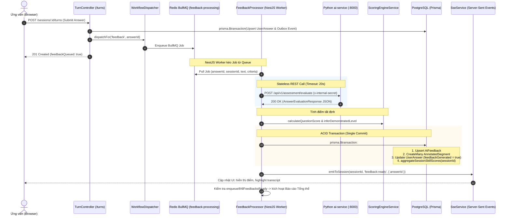

# TASK 3.5: ĐIỀU PHỐI BULLMQ OUTBOX & NESTJS FEEDBACK WORKER

> **Trạng thái**: Approved / Production Specification  
> **Cấp độ**: Deep Technical Specification (Distributed Systems & Workflow Orchestration)  
> **Áp dụng cho**: `server/src/modules/interview-assessment/evaluation/feedback/feedback.processor.ts`, BullMQ  
> **Tài liệu cha**: [00_PHASE_3_OVERVIEW_AND_ARCHITECTURE.md](00_PHASE_3_OVERVIEW_AND_ARCHITECTURE.md)  
> **Phiên bản**: 1.0.0  

---

## 1. NGUYÊN TẮC THIẾT KẾ: ĐƠN CONSUMER & STATELESS COMPUTE

> [!IMPORTANT]
> **Quy định Kiến trúc Bất biến**:
> 1. **NestJS [`FeedbackProcessor`](file:///c:/Users/An/Documents/GR1/InterviewCoach/server/src/modules/interview-assessment/evaluation/feedback/feedback.processor.ts) là Consumer duy nhất**: Chỉ có worker chạy trên NestJS runtime được phép kết nối và lắng nghe job từ Redis BullMQ (`feedback-processing`).
> 2. **Python `ai-service` là Stateless Compute Engine**: Tiếp nhận HTTP REST request `POST /api/v1/assessment/evaluate` và trả về kết quả JSON. Python **không** có worker lắng nghe trực tiếp từ Redis để tránh phụ thuộc chéo format và deadlock.
> 3. **ACID Transaction & Realtime Notification**: Toàn bộ thao tác ghi nhận kết quả đánh giá vào database và kích hoạt tổng hợp phiên đều do NestJS thực thi trong một `prisma.$transaction`.

---

## 2. QUY TRÌNH ĐIỀU PHỐI TUẦN TỰ (END-TO-END WORKFLOW)



---

## 3. CẤU HÌNH NESTJS WORKER (`server/src/modules/interview-assessment/evaluation/feedback/feedback.processor.ts`)

```typescript
import { Processor, WorkerHost } from '@nestjs/bullmq';
import { Injectable, Logger, Optional } from '@nestjs/common';
import { Job } from 'bullmq';
import { firstValueFrom } from 'rxjs';
import { HttpService } from '@nestjs/axios';
import { ConfigService } from '@nestjs/config';
import { PrismaService } from '@infra/database/prisma/prisma.service';
import { ScoringEngineService } from '../scoring-engine.service';
import { ReportService } from '../../report/report.service';
import { SseService } from '@core/sse/sse.service';
import { FEEDBACK_QUEUE } from './feedback.constants';

@Processor(FEEDBACK_QUEUE, {
  concurrency: 2,           // Tối đa 2 jobs đánh giá đồng thời trên mỗi worker instance
  lockDuration: 60_000,      // Khóa 60s để tránh worker khác cướp job khi LLM phản hồi chậm
  stalledInterval: 30_000,   // Quét job bị treo mỗi 30s
})
export class FeedbackProcessor extends WorkerHost {
  private readonly logger = new Logger(FeedbackProcessor.name);

  constructor(
    private readonly prisma: PrismaService,
    private readonly sseService: SseService,
    private readonly scoringEngine: ScoringEngineService,
    private readonly reportService: ReportService,
    private readonly config: ConfigService,
    private readonly httpService: HttpService,
    @Optional()
    private readonly localEvaluator?: BinaryCriteriaEvaluatorService,
  ) {
    super();
  }

  async process(job: Job<FeedbackJobDto>): Promise<void> {
    const { answerId, sessionId, questionId, questionText, answerText, sessionType, language } = job.data;
    const provider = this.config.get<string>('AI_EVALUATION_PROVIDER', 'python');

    const question = await this.prisma.sessionQuestion.findUnique({
      where: { id: questionId },
      select: { rubricCriteria: true, targetLevel: true, sfiaSkillCode: true },
    });

    const criteriaList = (question?.rubricCriteria as any[]) || [];
    let evaluationData: AnswerEvaluationResponseDto;

    if (provider === 'python') {
      try {
        const response = await firstValueFrom(
          this.httpService.post<AnswerEvaluationResponseDto>(
            `${this.config.get('AI_SERVICE_URL')}/api/v1/assessment/evaluate`,
            {
              sessionId,
              answerId,
              questionId,
              questionText,
              answerText,
              sessionType,
              language,
              sfiaSkillCode: question?.sfiaSkillCode,
              targetLevel: question?.targetLevel ?? 3,
              rubricCriteria: criteriaList,
            },
            {
              headers: { 'x-internal-secret': this.config.get('INTERNAL_AI_SECRET') },
              timeout: 20_000, // Timeout 20s
            },
          ),
        );
        evaluationData = response.data;
      } catch (error) {
        this.logger.warn(`Python evaluation failed, switching to local fallback: ${error.message}`);
        evaluationData = await this.localEvaluator!.evaluateFallback(job.data);
      }
    } else {
      evaluationData = await this.localEvaluator!.evaluate(job.data);
    }

    // 1. Tính điểm số và cấp độ tất định qua ScoringEngineService
    const scoring = this.scoringEngine.calculateQuestionScore(
      evaluationData.criteriaEvaluations,
      criteriaList,
    );
    const demonstratedLevel = this.scoringEngine.inferDemonstratedLevel(
      question?.targetLevel ?? 3,
      scoring.corePassRate,
      scoring.seniorityPassRate,
    );

    // 2. Lưu cơ sở dữ liệu trong 1 Transaction duy nhất
    await this.prisma.$transaction(async (tx) => {
      const aiFeedback = await tx.aiFeedback.upsert({
        where: { userAnswerId: answerId },
        create: {
          userAnswerId: answerId,
          overallScore: scoring.questionScore,
          demonstratedLevel,
          criteriaPassRate: scoring.criteriaPassRate,
          criteriaEvaluations: evaluationData.criteriaEvaluations as any,
          strengths: evaluationData.strengths,
          improvements: evaluationData.improvements,
          modelAnswer: evaluationData.modelAnswer,
          keyTakeaway: evaluationData.keyTakeaway,
          promptVersion: evaluationData.promptVersion,
          isFallback: false,
        },
        update: {
          overallScore: scoring.questionScore,
          demonstratedLevel,
          criteriaPassRate: scoring.criteriaPassRate,
          criteriaEvaluations: evaluationData.criteriaEvaluations as any,
          strengths: evaluationData.strengths,
          improvements: evaluationData.improvements,
          modelAnswer: evaluationData.modelAnswer,
          keyTakeaway: evaluationData.keyTakeaway,
          promptVersion: evaluationData.promptVersion,
        },
      });

      // Tạo mới danh sách annotated segments
      await tx.annotatedSegment.deleteMany({ where: { aiFeedbackId: aiFeedback.id } });
      if (evaluationData.annotatedSegments && evaluationData.annotatedSegments.length > 0) {
        await tx.annotatedSegment.createMany({
          data: evaluationData.annotatedSegments.map((seg) => ({
            aiFeedbackId: aiFeedback.id,
            segmentText: seg.segmentText,
            startIndex: seg.startIndex,
            endIndex: seg.endIndex,
            highlightLevel: seg.highlightLevel,
            annotation: seg.annotation,
            suggestion: seg.suggestion ?? null,
            improvedVersion: seg.improvedVersion ?? null,
          })),
        });
      }

      await tx.userAnswer.update({
        where: { id: answerId },
        data: { feedbackGenerated: true },
      });

      // Tự động tổng hợp điểm lũy kế cho session_skills
      await this.scoringEngine.aggregateSessionSkillScores(sessionId, tx);
    });

    // 3. Bắn event realtime về giao diện người dùng
    this.sseService.emitToSession(sessionId, 'feedback:ready', { answerId });

    // 4. Kích hoạt tạo Báo cáo Tổng thể nếu toàn bộ các câu hỏi đã có phản hồi
    await this.reportService.enqueueIfAllFeedbacksReady(sessionId, sessionType, 'VN', language);
  }
}
```

---

## 4. CHIẾN LƯỢC PHỤC HỒI LỖI (FAULT TOLERANCE & RETRY POLICY)

1. **BullMQ Automatic Retries**:
   * Cấu hình `attempts: 3` với `backoff: { type: 'exponential', delay: 3000 }`.
   * Nếu lần gọi đầu tiên bị timeout hoặc mạng gián đoạn, BullMQ tự động thử lại sau 3s, 6s.
2. **Circuit Breaker Fallback**:
   * Nếu sau 3 lần gọi Python service vẫn thất bại, hệ thống tự động kích hoạt `localEvaluator` chạy trực tiếp trên OpenAI API thông qua `AIGatewayDispatcher` để trả điểm cơ bản cho thí sinh, không bao giờ để job bị kẹt vô thời hạn.

---

## 5. TIÊU CHÍ NGHIỆM THU (QUALITY GATES)

1. **Xử lý Đồng thời Không Nghẽn**: Chạy kiểm thử tải với 50 câu trả lời nộp đồng thời, không có job nào bị mất mát (0% job loss) và không gây tràn RAM/Redis.
2. **Toàn vẹn Transaction**: Nếu quá trình ghi `annotated_segments` bị lỗi, transaction tự động rollback $100\%$, không để lại bản ghi rác mồ côi.
3. **Phản hồi Realtime Chuẩn xác**: Event `feedback:ready` được client nhận trong $< 300\text{ms}$ ngay sau khi transaction commit thành công.

---

## 6. TASK EXECUTION CONTRACT

### 6.1 Prerequisites (Tiền đề bắt buộc)
- [ ] Hoàn thành **Task 3.4**: Thuật toán `ScoringEngineService` đã được cài đặt và vượt qua bộ test tính tất định.
- [ ] Redis BullMQ queue `workflow-jobs` đã sẵn sàng và kết nối thành công.
- [ ] Database PostgreSQL có đầy đủ các bảng `ai_feedbacks`, `annotated_segments`, `user_answers`, `session_skills`.

### 6.2 Target Deliverables (Sản phẩm mã nguồn đầu ra)
- [ ] `server/src/modules/interview-assessment/evaluation/feedback/feedback.processor.ts`: BullMQ Worker kéo job `evaluate-answer`, gọi Python REST API, bọc ghi dữ liệu trong 1 `prisma.$transaction`.
- [ ] `server/src/infrastructure/ai/python-ai.gateway.ts`: Mở rộng phương thức `evaluateTurnAnswer()` gọi sang Python `/api/v1/assessment/evaluate`.
- [ ] `server/src/modules/interview-assessment/contracts/assessment-facade.service.ts`: Export method `enqueueEvaluationJob()`.
- [ ] `server/test/contracts/python-assessment.contract.spec.ts`: Jest Contract Test trên fixture `assessment-evaluate-response.fixture.json`.

### 6.3 Architectural Rules Enforced (Tuân thủ AGENTS.md)
- [x] **Backend Rule 1**: Toàn bộ luồng đánh giá liên module được kích hoạt qua `AssessmentFacade`.
- [x] **Backend Rule 2**: Controllers không chứa logic kéo/đẩy queue hay gọi Prisma trực tiếp.
- [x] **Backend Rule 3**: Ném ngoại lệ chuẩn `InterviewAIException(ErrorCode.EVALUATION_FAILED, ...)`.
- [x] **Backend Rule 5**: Toàn bộ việc lưu `aiFeedback`, `annotatedSegments`, cập nhật `userAnswer` và `sessionSkills` nằm trong duy nhất một `prisma.$transaction`.

### 6.4 Verification Command (Lệnh kiểm thử & Xác thực tự động)
```bash
# Tier 1 (NestJS Feedback Processor Unit Test)
cd server && npm run test -- src/modules/interview-assessment/evaluation/feedback/feedback.processor.spec.ts

# Tier 2 (Live BullMQ Outbox Processing E2E Test)
cd server && npm run test:e2e -- test/e2e/turn-evaluation-outbox.e2e-spec.ts
```

### 6.5 Definition of Done (DoD)
- [ ] **Quality Gate 3 Approved 100%**.
- [ ] Xử lý tải 50 jobs đồng thời không mất mát dữ liệu (0% job loss), không rò rỉ bộ nhớ Redis.
- [ ] Toàn vẹn ACID Transaction: Lỗi ghi chép ở bất kỳ bảng con nào đều kích hoạt rollback 100%.
- [ ] Event `feedback:ready` bắn qua SSE về client trong $< 300\text{ms}$ sau khi transaction commit.
- [ ] Idempotency: Gửi lại cùng một answerId không tạo ra duplicate feedback.

### 6.6 Next Task Transition (Bước chuyển tiếp)
- **HOÀN THÀNH PHASE 3 (ASSESSMENT & DETERMINISTIC SCORING)**.
- Bàn giao sang **Phase 4: Trải nghiệm Hỏi Đào Sâu Theo Lượt (Adaptive Probing)**: Bắt đầu tại [01_ADAPTIVE_PROBING_ENGINE_AND_BUDGET.md](../04_PHASE_4_VLLM_SCALING/01_ADAPTIVE_PROBING_ENGINE_AND_BUDGET.md).


