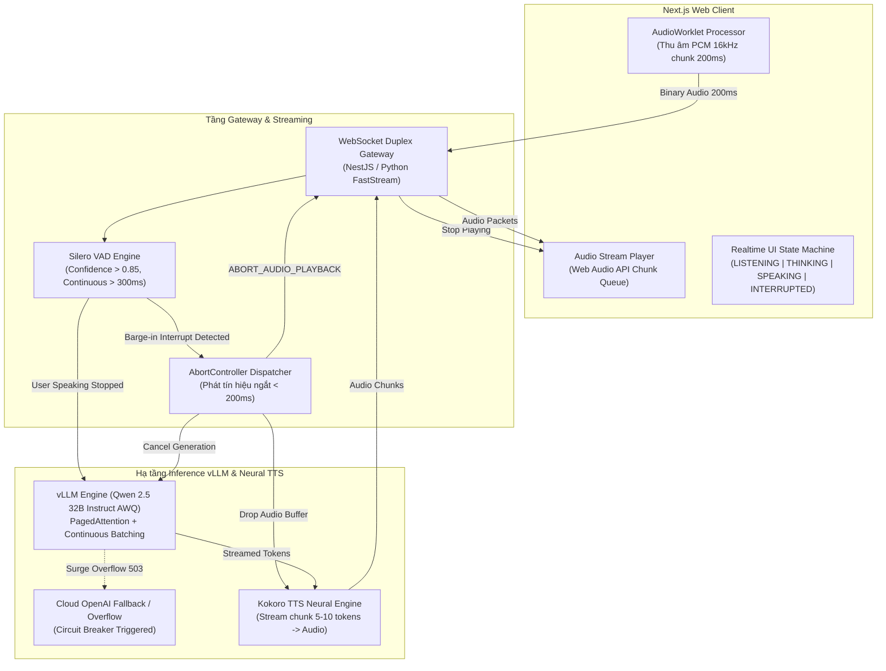

# TÀI LIỆU TỔNG QUAN: PHASE 4 — HẠ TẦNG VLLM TỰ HOST & TRỢ LÝ ĐÀM THOẠI SONG CÔNG
# (MASTER OVERVIEW, ROADMAP & DETAILED TASK BREAKDOWN)

> **Trạng thái**: Approved / Production Specification  
> **Áp dụng cho**: Hạ tầng GPU / vLLM, Trợ lý Phỏng vấn Thời gian thực, WebSockets Duplex, Smart VAD & Barge-in  
> **Tài liệu tham chiếu**: [00_OVERVIEW_STRATEGIC_BLUEPRINT.md](../00_OVERVIEW_STRATEGIC_BLUEPRINT.md), [01_PHASE_1_AUDIO_ENGINE_AND_PILOT.md](../01_PHASE_1_AUDIO_ENGINE_AND_PILOT.md)  
> **Phiên bản**: 2.0.0 (Đã phân rã thành bộ tài liệu chuyên sâu 5 tasks)  

---

## 1. TỔNG QUAN KIẾN TRÚC PHASE 4

Phase 4 nâng cấp hệ thống InterviewAI từ cơ chế hỏi-đáp ngắt quãng (turn-based request/response) lên **Trợ lý Phỏng vấn Đàm thoại Song công Thời gian thực (Full-Duplex Conversational Interviewer)** song hành với **Tự host vLLM (Open-Source LLM)** nhằm tối ưu hóa 90-95% Total Cost of Ownership (TCO) ở quy mô hàng chục nghìn phiên phỏng vấn.

---

## 2. BẢNG PHÂN TÍCH TỔNG CHI PHÍ SỞ HỮU (TCO ANALYSIS)

| Quy mô Phiên / Tháng | Token & Audio Minutes Ước tính | Chi phí Cloud API Thuần túy (GPT-4o + Whisper + ElevenLabs) | Chi phí Hạ tầng vLLM Tự Host (vLLM AWQ + faster-whisper + Kokoro) | Tỷ lệ Tiết kiệm Thực tế |
| :---: | :---: | :---: | :---: | :---: |
| **1.000 phiên** | 20M tokens + 15.000 phút audio | **~$420 / tháng** | **~$220 / tháng** (1x GPU RunPod On-Demand) | **48%** |
| **10.000 phiên** | 200M tokens + 150.000 phút audio | **~$4.200 / tháng** | **~$650 / tháng** (1x AWS G5.2xlarge Dedicated) | **85%** |
| **50.000 phiên** | 1.000M tokens + 750.000 phút audio | **~$21.000 / tháng** | **~$1.800 / tháng** (3x GPU Nodes Load Balanced) | **91%** |
| **100.000 phiên** | 2.000M tokens + 1.500.000 phút audio | **~$42.000 / tháng** | **~$3.200 / tháng** (Cluster GPU tự quản trị) | **92.4%** |

$$\Rightarrow \mathbf{Tại\ quy\ mô\ 100.000\ phiên/tháng,\ việc\ tự\ host\ vLLM\ giúp\ tiết\ kiệm\ hơn\ 950\ triệu\ VNĐ/tháng!}$$

---

## 3. DANH MỤC CÁC TÀI LIỆU CHUYÊN SÂU TỪNG TASK (TASK BREAKDOWN)

Phase 4 được chia thành 5 nhiệm vụ kỹ thuật độc lập với tài liệu đặc tả thực thi chi tiết:

| Thứ tự | Tệp Tài liệu Đặc tả | Trọng tâm Kỹ thuật & Phạm vi Triển khai |
| :---: | :--- | :--- |
| **Task 4.1** | [01_VLLM_CONTAINER_DEPLOYMENT_AND_QUANTIZATION.md](01_VLLM_CONTAINER_DEPLOYMENT_AND_QUANTIZATION.md) | Triển khai vLLM với mô hình `Qwen/Qwen2.5-32B-Instruct-AWQ` trên GPU 24GB VRAM (A10G/L4/RTX 4090), tối ưu PagedAttention, KV-Cache memory profiling và OpenAI-compatible HTTP/SSE endpoint. |
| **Task 4.2** | [02_NESTJS_GATEWAY_INTEGRATION_AND_SURGE_FAILOVER.md](02_NESTJS_GATEWAY_INTEGRATION_AND_SURGE_FAILOVER.md) | Tích hợp vLLM vào NestJS qua `OpenAIGateway`, cơ chế Circuit Breaker tự ngắt khi vLLM quá tải và thuật toán Cloud Surge Overflow điều hướng traffic sang OpenAI API. |
| **Task 4.3** | [03_FULL_DUPLEX_WEBSOCKET_AND_AUDIO_WORKLET.md](03_FULL_DUPLEX_WEBSOCKET_AND_AUDIO_WORKLET.md) | Xây dựng giao thức WebSockets đàm thoại hai chiều, pipeline AudioWorklet thu/phát âm thanh liên tục không block main thread, và FSM đồng bộ trạng thái hội thoại. |
| **Task 4.4** | [04_SMART_VAD_BARGE_IN_AND_LATENCY_PIPELINE.md](04_SMART_VAD_BARGE_IN_AND_LATENCY_PIPELINE.md) | Tích hợp Silero VAD lọc tiếng ồn giả, phát hiện ngắt lời (Barge-in), truyền phát tín hiệu hủy đa tầng (<200ms) qua `AbortController` đến vLLM và Kokoro TTS. |
| **Task 4.5** | [05_ADAPTIVE_PROBING_AND_CONVERSATIONAL_ORCHESTRATION.md](05_ADAPTIVE_PROBING_AND_CONVERSATIONAL_ORCHESTRATION.md) | Thuật toán nhận diện câu trả lời mơ hồ/lạc đề để tự động kích hoạt câu hỏi xoáy (Adaptive Follow-up Probing), kiểm soát độ sâu đàm thoại và chốt chất lượng phỏng vấn. |

---

## 4. LỘ TRÌNH TRIỂN KHAI & TIÊU CHÍ NGHIỆM THU TỔNG THỂ

1. **Tuần 1 (Hạ tầng LLM & Gateway)**: Hoàn tất Task 4.1 và Task 4.2. Đảm bảo NestJS gọi vLLM cục bộ với độ trễ First Token $< 300\text{ ms}$, tự động fallback sang OpenAI khi container vLLM dừng.
2. **Tuần 2 (Duplex Audio & VAD Barge-in)**: Hoàn tất Task 4.3 và Task 4.4. Đảm bảo ứng viên nói chuyện liên tục qua WebSocket, độ trễ Time-to-First-Audio $< 800\text{ ms}$, phản hồi ngắt lời $< 200\text{ ms}$.
3. **Tuần 3 (Adaptive Probing & Quality Validation)**: Hoàn tất Task 4.5. AI tự phát hiện STAR thiếu sót và đặt tối đa 2 câu hỏi xoáy tự nhiên trước khi chuyển câu tiếp theo.
