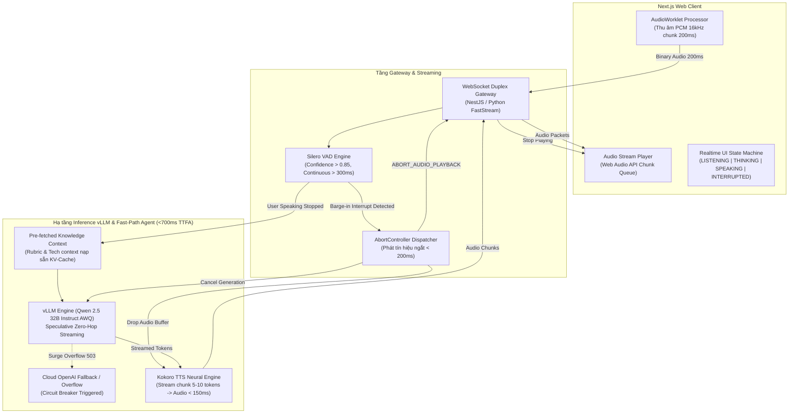

# TÀI LIỆU TỔNG QUAN: PHASE 4 — HẠ TẦNG VLLM TỰ HOST & FAST-PATH CONVERSATIONAL AGENT
# (MASTER OVERVIEW, ROADMAP & DETAILED TASK BREAKDOWN)

> **Trạng thái**: Approved / Production Specification  
> **Cấp độ**: Production Specification (System Architect / Lead Engineer)  
> **Áp dụng cho**: Hạ tầng GPU / vLLM, Trợ lý Phỏng vấn Thời gian thực, WebSockets Duplex, Smart VAD & Barge-in  
> **Tài liệu tham chiếu**: [00_OVERVIEW_STRATEGIC_BLUEPRINT.md](../00_OVERVIEW_STRATEGIC_BLUEPRINT.md), [01_PHASE_1_AUDIO_ENGINE_AND_PILOT.md](../01_PHASE_1_AUDIO_ENGINE_AND_PILOT.md)  
> **Phiên bản**: 3.0.0 (Tái cấu trúc tích hợp Fast-Path Conversational Agent <900ms)  

---

## 1. TỔNG QUAN KIẾN TRÚC PHASE 4

Phase 4 nâng cấp hệ thống InterviewAI từ cơ chế hỏi-đáp ngắt quãng (Turn-by-Turn request/response) lên **Full-Duplex Conversational Interviewer** tích hợp **Fast-Path Conversational Agent** song hành với **Tự host vLLM (Open-Source LLM)** nhằm tối ưu hóa 90-95% Total Cost of Ownership (TCO) ở quy mô lớn:



---

## 2. BẢNG PHÂN TÍCH TỔNG CHI PHÍ SỞ HỮU (TCO ANALYSIS)

| Quy mô Phiên / Tháng | Token & Audio Minutes Ước tính | Chi phí Cloud API Thuần túy (GPT-4o + Whisper + ElevenLabs) | Chi phí Hạ tầng vLLM Tự Host (vLLM AWQ + faster-whisper + Kokoro) | Tỷ lệ Tiết kiệm Thực tế |
| :---: | :---: | :---: | :---: | :---: |
| **1.000 phiên** | 20M tokens + 15.000 phút audio | **~$420 / tháng** | **~$220 / tháng** (1x GPU RunPod On-Demand) | **48%** |
| **10.000 phiên** | 200M tokens + 150.000 phút audio | **~$4.200 / tháng** | **~$650 / tháng** (1x AWS G5.2xlarge Dedicated) | **85%** |
| **50.000 phiên** | 1.000M tokens + 750.000 phút audio | **~$21.000 / tháng** | **~$1.800 / tháng** (3x GPU Nodes Load Balanced) | **91%** |
| **100.000 phiên** | 2.000M tokens + 1.500.000 phút audio | **~$42.000 / tháng** | **~$3.200 / tháng** (Cluster GPU tự quản trị) | **92.4%** |

$$\Rightarrow \mathbf{Tại\ quy\ mô\ 100.000\ phiên/tháng,\ việc\ tự\ host\ vLLM\ giúp\ tiết\ kiệm\ hơn\ 950\ triệu\ VNĐ/tháng!}$$

---

## 3. DANH MỤC CÁC TÀI LIỆU CHUYÊN SÂU TỪNG TASK (TASK BREAKDOWN)

Phase 4 được chia thành 5 nhiệm vụ kỹ thuật độc lập với tài liệu đặc tả thực thi chi tiết:

| Thứ tự | Tệp Tài liệu Đặc tả | Trọng tâm Kỹ thuật & Phạm vi Triển khai |
| :---: | :--- | :--- |
| **Task 4.1** | [01_VLLM_CONTAINER_DEPLOYMENT_AND_QUANTIZATION.md](01_VLLM_CONTAINER_DEPLOYMENT_AND_QUANTIZATION.md) | Triển khai vLLM với mô hình `Qwen/Qwen2.5-32B-Instruct-AWQ` trên GPU 24GB VRAM (A10G/L4/RTX 4090), tối ưu PagedAttention, KV-Cache memory profiling và OpenAI-compatible HTTP/SSE endpoint. |
| **Task 4.2** | [02_NESTJS_GATEWAY_INTEGRATION_AND_SURGE_FAILOVER.md](02_NESTJS_GATEWAY_INTEGRATION_AND_SURGE_FAILOVER.md) | Tích hợp vLLM vào NestJS qua `OpenAIGateway`, cơ chế Circuit Breaker tự ngắt khi vLLM quá tải và thuật toán Cloud Surge Failover điều hướng traffic sang OpenAI API. |
| **Task 4.3** | [03_FULL_DUPLEX_WEBSOCKET_AND_AUDIO_WORKLET.md](03_FULL_DUPLEX_WEBSOCKET_AND_AUDIO_WORKLET.md) | Xây dựng giao thức WebSockets đàm thoại hai chiều, pipeline AudioWorklet thu/phát âm thanh liên tục không block main thread, và FSM đồng bộ trạng thái hội thoại. |
| **Task 4.4** | [04_SMART_VAD_BARGE_IN_AND_LATENCY_PIPELINE.md](04_SMART_VAD_BARGE_IN_AND_LATENCY_PIPELINE.md) | Tích hợp Silero VAD lọc tiếng ồn giả, phát hiện ngắt lời (Barge-in), truyền phát tín hiệu hủy đa tầng (<200ms) qua `AbortController` đến vLLM và Kokoro TTS. |
| **Task 4.5** | [05_ADAPTIVE_PROBING_AND_CONVERSATIONAL_ORCHESTRATION.md](05_ADAPTIVE_PROBING_AND_CONVERSATIONAL_ORCHESTRATION.md) | Fast-Path Conversational Agent: Cơ chế Speculative Zero-Hop Probing với Pre-fetched KV-Cache Context, ngân sách hỏi xoáy nghiêm ngặt (Junior <= 1, Senior <= 2), Time-to-First-Audio $< 700\text{ms}$. |

---

## 4. KHUNG BÀN GIAO & LIÊN KẾT TUẦN TỰ (PHASE 4 EXECUTION & HANDOVER PROTOCOL)

### 4.1 Tiền đề Bàn giao Nhận từ Phase 3 (Incoming Handover)
* Pipeline đánh giá câu trả lời kết hợp Multi-Agent Fact-Checking đã hoàn thiện và chạy ổn định qua BullMQ Outbox Worker.
* Đã vượt qua toàn bộ tiêu chí của **Quality Gate 3**.

### 4.2 Chuỗi Thực thi Tuần tự (Task Sequential Flow)
```
Task 4.1 (vLLM Deployment) ──> Task 4.2 (Gateway & Failover) ──> Task 4.3 (Full-Duplex WS)
                                                                           │
Task 4.5 (Fast-Path Agent) <── Task 4.4 (Smart VAD Barge-in) <─────────────┘
```

### 4.3 Handover Sang Phase 5 (Phase 4 -> Phase 5 Transition)
* **Điều kiện hoàn thành Phase 4**: Vượt qua toàn bộ tiêu chí của **Quality Gate 4**.
* **Đầu ra bàn giao**: Cụm suy luận vLLM và WebSocket Full-Duplex Gateway tích hợp Fast-Path Conversational Agent hoạt động hoàn chỉnh ở môi trường Dev.
* **Tài liệu chuyển tiếp**: Chuyển sang Phase 5 tại [00_PHASE_5_OVERVIEW_AND_ARCHITECTURE.md](../05_PHASE_5_DEV_OPS_INFRA/00_PHASE_5_OVERVIEW_AND_ARCHITECTURE.md) (Task 5.1: Polyglot Monorepo & Multi-stage Containers).

---

## 5. CHỈ TIÊU NGHIỆM THU TỔNG THỂ (QUALITY GATE 4)

1. **Độ Trễ Đàm Thoại Toàn Trình (Time-to-First-Audio)**: Từ khi ứng viên dứt lời đến khi nghe thấy tiếng AI phản hồi $< 800\text{ ms}$ (P95) và $< 700\text{ ms}$ (Average).
2. **Độ Nhạy Ngắt Lời (Barge-in Latency)**: Dừng phát loa và giải phóng tài nguyên tính toán trong vòng $< 200\text{ ms}$ sau khi ứng viên cất lời.
3. **Hiệu Năng & Ổn Định GPU**: Cụm vLLM chịu tải ổn định $\ge 30$ lượt suy luận song song với tốc độ sinh token $\ge 25\text{ tokens/giây/luồng}$.
4. **Bảo Vệ Dự Phòng (Cloud Surge Failover)**: Khi vLLM quá tải hoặc gặp sự cố, hệ thống tự động chuyển mạch sang OpenAI Cloud Fallback trong $< 1.5\text{s}$ mà không làm đứt đoạn phiên phỏng vấn.
