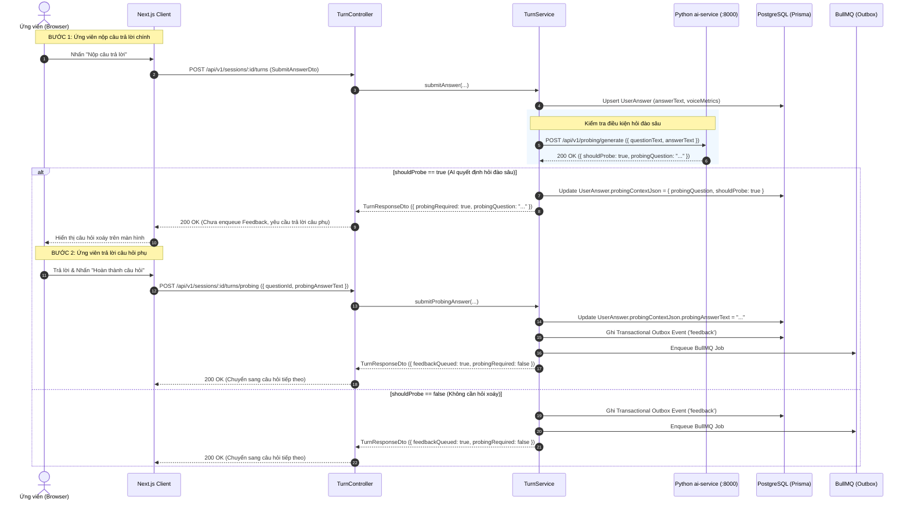

# TASK 4.2: NESTJS ADAPTIVE PROBING INTAKE & SUB-TURN DATA MODEL
# (TÍCH HỢP HỎI ĐÀO SÂU PHÍA NESTJS, MÔ HÌNH DỮ LIỆU SUB-TURN & GIAO DIỆN PHỎNG VẤN 2 BƯỚC)

> **Trạng thái**: Approved / Pragmatic Production Specification  
> **Cấp độ**: Deep Technical Specification (Full-Stack Backend Integration & UI State Machine)  
> **Áp dụng cho**: `server/src/modules/interview-live/turn/`, `server/prisma/schema.prisma`, `client/components/interview/`  
> **Tài liệu cha**: [00_PHASE_4_OVERVIEW_AND_ARCHITECTURE.md](00_PHASE_4_OVERVIEW_AND_ARCHITECTURE.md)  
> **Phiên bản**: 2.0.0 (Tích hợp luồng Sub-turn lưu trữ an toàn trong UserAnswer)  

---

## 1. MỤC TIÊU KỸ THUẬT & TÍNH TOÀN VẸN CƠ SỞ DỮ LIỆU

Để bổ sung khả năng hỏi đào sâu mà **không làm vỡ cấu trúc cơ sở dữ liệu hiện có**:
1. **Bảo tồn Ràng buộc Duy nhất**: Bảng `session_questions` có ràng buộc duy nhất `@@unique([sessionId, orderIndex])`. Nếu chèn một câu hỏi mới vào giữa phiên, hệ thống sẽ phải cập nhật lại hàng loạt `orderIndex` của các câu hỏi phía sau, gây nguy cơ Deadlock / Table Lock trong phiên live.
2. **Giải pháp Sub-Turn trong `UserAnswer`**:
   - Câu hỏi đào sâu được coi là một **lượt trả lời bổ trợ (Sub-Turn)** gắn liền với chính câu hỏi đó.
   - Thêm cột `probing_context_json` vào bảng [`user_answers`](file:///c:/Users/An/Documents/GR1/InterviewCoach/server/prisma/schema.prisma).
   - Khi đánh giá năng lực tại Phase 3, câu trả lời chính và câu trả lời đào sâu được nối lại để LLM thẩm định toàn diện.

---

## 2. DDL MIGRATION & MÔ HÌNH DỮ LIỆU

### 2.1 Prisma Schema Migration (`server/prisma/schema.prisma`)

```prisma
model UserAnswer {
  id                   String          @id @default(dbgenerated("gen_random_uuid()")) @db.Uuid
  questionId           String          @unique @map("question_id") @db.Uuid
  answerMode           String          @map("answer_mode")
  answerText           String          @map("answer_text")
  audioDurationSeconds Int?            @map("audio_duration_seconds")
  skipped              Boolean         @default(false)
  voiceMetricsJson     Json?           @map("voice_metrics_json")
  
  // === TRƯỜNG MỚI LƯU SUB-TURN HỎI XOÁY ĐÁP SÂU ===
  probingContextJson   Json?           @map("probing_context_json")
  
  feedbackGenerated    Boolean         @default(false) @map("feedback_generated")
  createdAt            DateTime        @default(now()) @map("created_at") @db.Timestamptz(6)
  updatedAt            DateTime        @default(now()) @updatedAt @map("updated_at") @db.Timestamptz(6)

  aiFeedback           AiFeedback?
  question             SessionQuestion @relation(fields: [questionId], references: [id], onDelete: Cascade)

  @@index([questionId], map: "idx_user_answers_question_id")
  @@map("user_answers")
}
```

### 2.2 Cấu trúc JSON `probing_context_json`

```typescript
export interface ProbingContextData {
  shouldProbe: boolean;
  probingQuestion?: string;
  probingRationale?: string;
  probingAnswerText?: string;
  probingAudioDurationSeconds?: number;
  probingVoiceMetricsJson?: Record<string, unknown>;
  answeredAt?: string;
}
```

---

## 3. SƠ ĐỒ TUẦN TỰ LUỒNG TURN-BASED PROBING (SEQUENCE DIAGRAM)



---

## 4. TỔNG HỢP VÀO ĐÁNH GIÁ (SYNTHESIS IN PHASE 3)

Khi worker BullMQ chạy đánh giá câu trả lời ở Task 3.3, nếu `probingContextJson` có chứa `probingAnswerText`, worker sẽ tự động nối nội dung để gửi sang Python Assessment API:

```typescript
const combinedAnswerText = userAnswer.probingContextJson?.probingAnswerText
  ? `${userAnswer.answerText}\n\n[Câu trả lời bổ sung cho câu hỏi đào sâu '${userAnswer.probingContextJson.probingQuestion}']:\n${userAnswer.probingContextJson.probingAnswerText}`
  : userAnswer.answerText;
```

Cơ chế này giúp LLM đánh giá trọn vẹn cả kiến thức ban đầu và chiều sâu tư duy khi bị hỏi xoáy mà không cần viết thêm prompt phức tạp.
