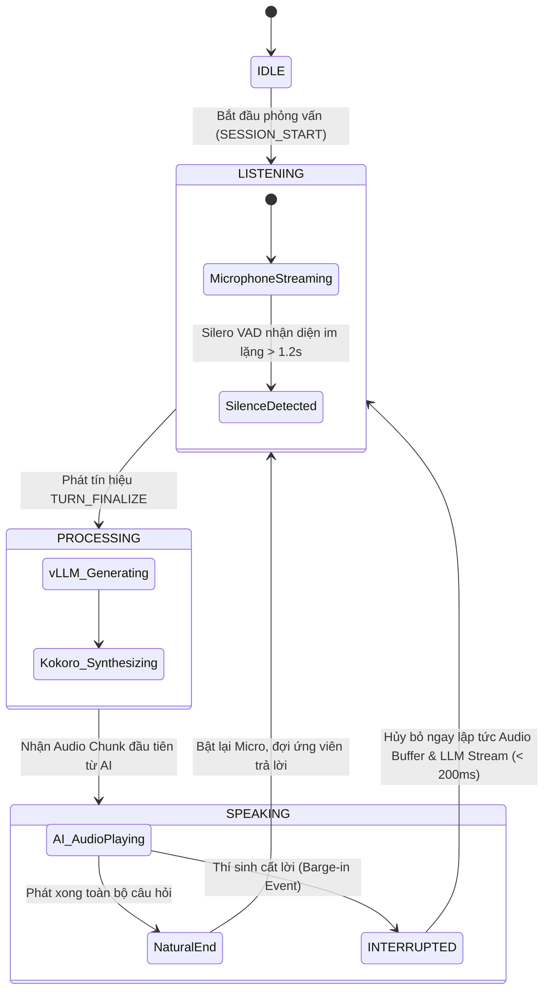

# TASK 4.3: GIAO THỨC WEBSOCKET SONG CÔNG & CLIENT AUDIOWORKLET STREAMING
# (FULL-DUPLEX WEBSOCKETS, AUDIOWORKLET PCM 16KHZ & CONVERSATIONAL FINITE STATE MACHINE)

> **Trạng thái**: Approved / Production Specification  
> **Cấp độ**: Deep Technical Specification (Real-Time Audio Streaming & Client Engine)  
> **Áp dụng cho**: `client/src/features/interview/`, Web Audio API, WebSocket Gateway, AudioWorklet  
> **Tài liệu cha**: [00_PHASE_4_OVERVIEW_AND_ARCHITECTURE.md](00_PHASE_4_OVERVIEW_AND_ARCHITECTURE.md)  
> **Phiên bản**: 2.0.0  

---

## 1. PHÂN TÍCH THIẾT KẾ CŨ & NHỮNG ĐIỂM CHƯA CHẶT CHẼ CẦN KHẮC PHỤC

Bản phác thảo ban đầu chỉ đề cập chung chung *"Next.js Client gửi binary audio chunk mỗi 200ms qua WebSocket"*. Thiết kế này còn thiếu **3 thành phần kiến trúc trọng yếu**:

1. **Rủi ro Sử dụng `MediaRecorder` Gây Nghẽn Main Thread**:
   * API `MediaRecorder` chạy trên Main Thread của trình duyệt. Khi Next.js re-render giao diện phức tạp (vẽ waveform, cập nhật text transcript), `MediaRecorder` bị nghẽn (jitter/drop frames), làm âm thanh bị giật và độ trễ tăng vọt $> 800\text{ms}$.
   * *Giải pháp khắc phục*: Bắt buộc sử dụng **`AudioWorkletNode`** chạy trên luồng Audio chuyên biệt riêng của trình duyệt (Web Audio API Dedicated Thread), đảm bảo lấy mẫu âm thanh đều đặn chính xác từng mili-giây.
2. **Thiếu Giao thức Đóng gói Nhị phân (Binary Framing Protocol)**:
   * Nếu chỉ gửi binary thô mà không có header phân loại, server không thể phân biệt giữa: Âm thanh người dùng nói, Tín hiệu điều khiển (`INTERRUPT`, `PING`), và Dữ liệu cấu hình.
   * *Giải pháp khắc phục*: Thiết lập chuẩn **Binary Packet Framing (5-byte Header)** siêu nhẹ.
3. **Hiện tượng Vang Vọng (Acoustic Echo / Double Playback)**:
   * Khi loa máy tính phát tiếng của AI, micro của thí sinh sẽ thu lại chính tiếng đó và gửi ngược lại server nếu không có máy trạng thái kiểm soát (Conversational FSM).

---

## 2. GIAO THỨC ĐÓNG GÓI NHỊ PHÂN SIÊU NHẸ (BINARY FRAMING PROTOCOL)

Mọi gói tin truyền qua WebSocket giữa Trình duyệt và Server tuân theo cấu trúc nhị phân 5-byte header:

```
+---------------+------------------------+---------------------------------------+
| Type (1 Byte) | Payload Length (4 Bytes| Payload Data (N Bytes)               |
|               | Big-Endian Uint32)     | (PCM Audio, UTF-8 JSON, Control Signal|
+---------------+------------------------+---------------------------------------+
```

### Bảng Mã Định danh Gói tin (Packet Type):
* `0x01` (`AUDIO_CHUNK_UP`): Dữ liệu âm thanh từ Microphone (PCM 16kHz, 16-bit Mono Little-Endian, mỗi chunk 200ms = 6.400 bytes).
* `0x02` (`AUDIO_CHUNK_DOWN`): Dữ liệu âm thanh AI đọc câu hỏi từ Kokoro TTS (WAV/PCM chunk).
* `0x03` (`CONTROL_INTERRUPT`): Tín hiệu khẩn cấp thông báo thí sinh ngắt lời (Barge-in Event).
* `0x04` (`CONTROL_STATE_SYNC`): Đồng bộ trạng thái hội thoại (JSON Payload).
* `0x05` (`HEARTBEAT_PING_PONG`): Giữ kết nối WebSocket không bị ngắt qua NAT firewall.

---

## 3. TRIỂN KHAI AUDIOWORKLET TRÊN CLIENT (`client/public/worklets/pcm-recorder.worklet.js`)

Mã nguồn chạy trên Audio Thread riêng biệt của trình duyệt, tự động gom 3.200 mẫu (200ms ở tần số 16kHz) và gửi về main thread:

```javascript
class PCMRecorderProcessor extends AudioWorkletProcessor {
  constructor() {
    super();
    this.bufferSize = 3200; // 200ms tại 16000Hz
    this.buffer = new Int16Array(this.bufferSize);
    this.bufferIndex = 0;
  }

  process(inputs) {
    const input = inputs[0];
    if (!input || !input[0]) return true;

    const channelData = input[0]; // Float32Array [-1.0, 1.0]

    for (let i = 0; i < channelData.length; i++) {
      // Chuyển đổi Float32 sang Int16 PCM chuẩn
      const s = Math.max(-1, Math.min(1, channelData[i]));
      this.buffer[this.bufferIndex++] = s < 0 ? s * 0x8000 : s * 0x7fff;

      if (this.bufferIndex >= this.bufferSize) {
        // Gửi mảng Int16 hoàn chỉnh về Main Thread qua Transferable ArrayBuffer
        this.port.postMessage(this.buffer.buffer, [this.buffer.buffer]);
        this.buffer = new Int16Array(this.bufferSize);
        this.bufferIndex = 0;
      }
    }

    return true;
  }
}

registerProcessor('pcm-recorder-processor', PCMRecorderProcessor);
```

---

## 4. MÁY TRẠNG THÁI HỘI THOẠI TOÀN DIỆN (CONVERSATIONAL FSM)

Để triệt tiêu lỗi chồng chéo âm thanh, client và server duy trì một Finite State Machine (FSM) nghiêm ngặt:



### Quy tắc Chống Echo (Echo Cancellation Guardrail):
* Khi ở trạng thái `SPEAKING`, mic của thí sinh vẫn mở nhưng luồng âm thanh được đưa qua bộ lọc VAD với **ngưỡng âm lượng lọc thông (Energy Gate Threshold)** nhằm tránh tiếng AI từ loa lọt ngược vào micro bị hiểu nhầm là người nói.

---

## 5. TIÊU CHÍ NGHIỆM THU (QUALITY GATES)

1. **Tần Suất Cắt Mẫu Chuẩn Xác**: `AudioWorklet` gửi chunk đều đặn $200\text{ ms} \pm 5\text{ ms}$ mà không bị trôi thời gian (drift).
2. **Không Treo Trình Duyệt**: Khi chạy liên tục trong phiên phỏng vấn 45 phút, mức tiêu thụ CPU của tab trình duyệt $< 6\%$ và không có rò rỉ bộ nhớ (Memory Leak).
3. **Chuyển Trạng Thái Tức thì**: Thời gian từ khi chuyển sang `INTERRUPTED` đến khi loa dừng phát âm thanh hoàn toàn $< 120\text{ ms}$.
