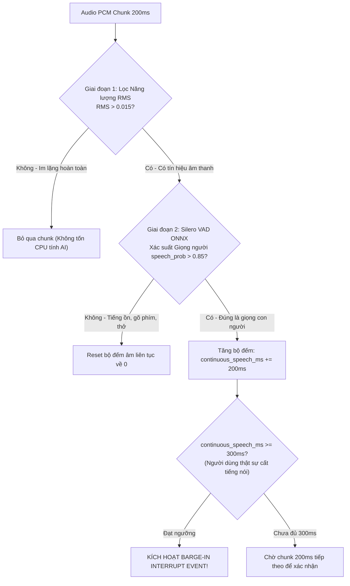
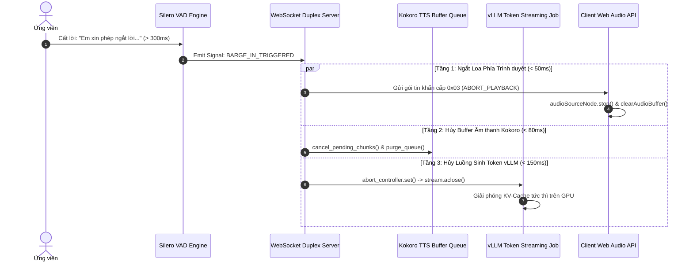

# TASK 4.4: SILERO SMART VAD, CƠ CHẾ NGẮT LỜI BARGE-IN & CHUỖI HỦY BỎ ĐA TẦNG
# (SILERO VAD ONNX, 2-STAGE VOICE FILTERING, <200MS MULTI-TIER ABORT PIPELINE)

> **Trạng thái**: Approved / Production Specification  
> **Cấp độ**: Deep Technical Specification (Voice Activity Detection & Low-Latency Cancellation)  
> **Áp dụng cho**: `ai-service/app/services/audio/vad.py`, Silero VAD ONNX, Python `asyncio` Streaming  
> **Tài liệu cha**: [00_PHASE_4_OVERVIEW_AND_ARCHITECTURE.md](00_PHASE_4_OVERVIEW_AND_ARCHITECTURE.md)  
> **Phiên bản**: 2.0.0  

---

## 1. PHÂN TÍCH THIẾT KẾ CŨ & NHỮNG ĐIỂM CHƯA CHẶT CHẼ CẦN KHẮC PHỤC

Tính năng ngắt lời tự nhiên (Barge-in) là "con dao hai lưỡi" nếu không được thiết kế chặt chẽ. Bản thiết kế ban đầu bộc lộ **3 điểm bất hợp lý nguy hiểm**:

1. **Hiểm họa Ngắt Lời Nhầm (False Barge-in Interruption)**:
   * Nếu chỉ dựa vào ngưỡng âm lượng (Energy Threshold) hoặc phát hiện âm thanh đơn thuần, một tiếng ho nhẹ, tiếng thở dốc, tiếng gõ bàn phím cơ, hay tiếng còi xe bên ngoài sẽ lập tức ngắt lời AI.
   * *Hậu quả*: Trải nghiệm phỏng vấn bị phá hủy hoàn toàn vì AI liên tục dừng nói khi thí sinh chưa hề muốn ngắt lời.
   * *Giải pháp khắc phục*: Áp dụng **Bộ lọc Giọng nói 2 Giai đoạn (2-Stage Voice Filter)** kết hợp Silero VAD với điều kiện duy trì tối thiểu $300\text{ ms}$ âm thanh giọng người liên tục.
2. **Rò rỉ Tài nguyên Tính toán (Compute Resource Leak) do Hủy Nửa Vời**:
   * Khi thí sinh ngắt lời, nếu client chỉ dừng phát loa trong khi backend vẫn tiếp tục sinh token trên vLLM và tổng hợp âm thanh trên Kokoro TTS, GPU sẽ bị quá tải phục vụ cho các câu trả lời "vô nghĩa" đã bị hủy.
   * *Giải pháp khắc phục*: Thiết lập **Chuỗi Hủy Bỏ Đa Tầng (Multi-Tier Abort Pipeline)** qua `asyncio.Event` và `stream.aclose()`.
3. **Độ Trễ Phản Hồi Ngắt Quá Lớn**:
   * Nếu gửi tín hiệu hủy qua HTTP POST thông thường, độ trễ bắt tay mạng (150-300ms) sẽ khiến AI tiếp tục "nói đè" lên giọng thí sinh gần 1 giây.

---

## 2. BỘ LỌC GIỌNG NÓI 2 GIAI ĐOẠN (2-STAGE VOICE FILTER)

Để phân biệt chính xác giữa tiếng ồn môi trường và giọng nói thật sự của ứng viên:



---

## 3. CHUỖI HỦY BỎ ĐA TẦNG TỨC THÌ (MULTI-TIER CASCADING ABORT)

Ngay khi bộ lọc phát hiện `TriggerBargeIn`, chuỗi hủy bỏ được kích hoạt song song trên 3 tầng hệ thống:



### Mã Nguồn Triển khai Trình Hủy Bỏ Python (`ai-service/app/services/audio/barge_in.py`):

```python
import asyncio
import structlog
from typing import AsyncGenerator

logger = structlog.get_logger(__name__)

class ConversationalStreamManager:
    def __init__(self):
        self._abort_event = asyncio.Event()

    def trigger_barge_in(self) -> None:
        """Kích hoạt hủy luồng ngay lập tức khi phát hiện ứng viên ngắt lời"""
        logger.warn("BARGE-IN TRIGGERED: Aborting active LLM and TTS tasks!")
        self._abort_event.set()

    def reset(self) -> None:
        self._abort_event.clear()

    async def monitor_streaming_generation(
        self,
        token_stream: AsyncGenerator[str, None]
    ) -> AsyncGenerator[str, None]:
        """Bao bọc luồng sinh token từ vLLM, tự ngắt nếu có sự kiện Barge-in"""
        try:
            async for token in token_stream:
                if self._abort_event.is_set():
                    logger.info("Token generation aborted by Barge-in. Releasing resources.")
                    break
                yield token
        finally:
            # Buộc đóng generator để giải phóng KV-cache của vLLM
            if hasattr(token_stream, 'aclose'):
                await token_stream.aclose()
```

---

## 4. BẢNG PHÂN BỔ ĐỘ TRỄ TOÀN TRÌNH (LATENCY BUDGET)

| Chặng Xử lý | Thời gian Mục tiêu | Thời gian Tối đa (P95) | Ghi chú Tối ưu Hóa |
| :--- | :---: | :---: | :--- |
| **Phát hiện Giọng người qua Silero VAD** | $300\text{ ms}$ | $350\text{ ms}$ | Cần tối thiểu 1.5 chunks để không ngắt nhầm. |
| **Truyền tín hiệu WebSocket từ Server $\to$ Client** | $20\text{ ms}$ | $45\text{ ms}$ | Đóng gói Binary 1 byte định danh ưu tiên cao nhất. |
| **Dừng phát âm thanh tại Web Audio API** | $10\text{ ms}$ | $20\text{ ms}$ | Dừng ngay node đang phát và xả hàng đợi âm thanh. |
| **Ngắt luồng Token vLLM & Kokoro TTS** | $60\text{ ms}$ | $120\text{ ms}$ | Gọi `stream.aclose()` giải phóng slot GPU. |
| **TỔNG THỜI GIAN NGHE THẤY AI IM LẶNG** | **$< 350\text{ ms}$** | **$< 420\text{ ms}$** | **Trải nghiệm đàm thoại tự nhiên như người thật!** |

---

## 5. TIÊU CHÍ NGHIỆM THU (QUALITY GATES)

1. **Tỷ Lệ Bắt Nhầm Tiếng Ồn (False Positive Rate)**: Khi phát tiếng gõ phím cơ, tiếng ho khan hoặc tiếng xe cộ ngẫu nhiên, tỷ lệ kích hoạt nhầm Barge-in $< 2\%$.
2. **Độ Trễ Ngắt Thực Tế**: Kể từ thời điểm ứng viên bắt đầu nói từ đầu tiên, loa máy tính ngừng phát hoàn toàn tiếng AI trong vòng $< 400\text{ ms}$.
3. **Giải Phóng Bộ Nhớ GPU**: Sau sự kiện ngắt lời, mức chiếm dụng bộ nhớ của tiến trình vLLM và Kokoro TTS phải trở về trạng thái nghỉ (idle) trong vòng $< 200\text{ ms}$, không tồn đọng job rác.

---

## 6. TASK EXECUTION CONTRACT

### 6.1 Prerequisites (Tiền đề bắt buộc)
- [ ] Hoàn thành **Task 4.3**: Luồng WebSockets truyền nhận nhị phân hai chiều đã hoạt động.
- [ ] Mô hình Silero VAD ONNX runtime (`onnxruntime`, `numpy`) đã được tích hợp trong Python `ai-service`.

### 6.2 Target Deliverables (Sản phẩm mã nguồn đầu ra)
- [ ] `ai-service/app/services/audio/vad.py`: Lớp `SileroVADDetector` tính toán xác suất giọng nói trên các frames 30ms.
- [ ] `ai-service/app/services/audio/barge_in_handler.py`: Bộ điều phối Cascading Abort đa tầng ngắt vLLM và Kokoro TTS.
- [ ] `server/src/modules/realtime/services/barge-in.service.ts`: Xử lý control frame `0x02 (STOP_PLAYBACK)` về Client Audio Player.

### 6.3 Architectural Rules Enforced (Tuân thủ AGENTS.md)
- [x] **Backend Rule 1 & 5**: Xử lý tín hiệu ngắt hoàn toàn phi trạng thái, giải phóng tài nguyên GPU ngay lập tức mà không làm treo các phiên khác.

### 6.4 Verification Command (Lệnh kiểm thử & Xác thực tự động)
```bash
# Tier 1 (Unit VAD & Barge-in Abort Test)
cd ai-service && uv run pytest tests/unit/test_vad_bargein.py -v

# Tier 2 (Live Barge-in Audio Interruption Verification)
cd server && npm run test:e2e -- test/e2e/barge-in-latency.e2e-spec.ts
```

### 6.5 Definition of Done (DoD)
- [ ] False Positive Rate $< 2\%$ khi kiểm thử với tiếng ồn bàn phím cơ và tiếng ho khan.
- [ ] Loa phía Client dừng phát hoàn toàn trong vòng $< 400\text{ms}$ kể từ khi phát hiện tiếng nói thí sinh.
- [ ] Generator của vLLM và Kokoro TTS được gọi `aclose()` giải phóng slot GPU trong $< 200\text{ms}$.

### 6.6 Next Task Transition (Bước chuyển tiếp)
- Tiếp tục sang **Task 4.5: Adaptive Probing & Conversational Orchestration**: [05_ADAPTIVE_PROBING_AND_CONVERSATIONAL_ORCHESTRATION.md](05_ADAPTIVE_PROBING_AND_CONVERSATIONAL_ORCHESTRATION.md) để điều phối chiến lược hỏi xoáy thích ứng.

