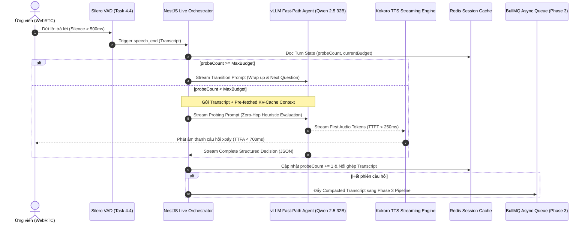
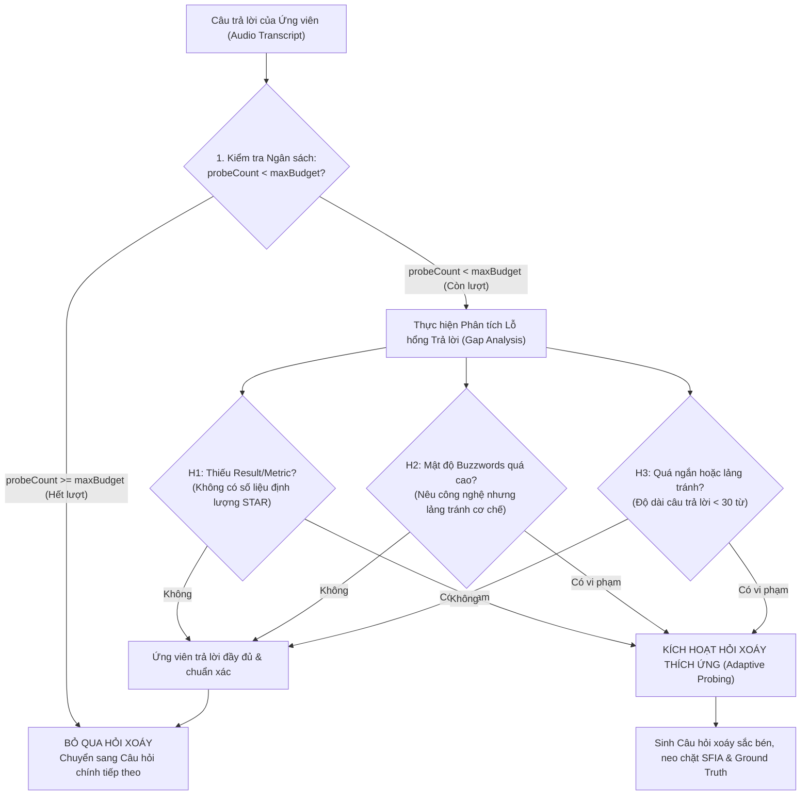

# TASK 4.5: FAST-PATH CONVERSATIONAL AGENT, SPECULATIVE ZERO-HOP PROBING & MULTI-TURN ORCHESTRATION
# (CƠ CHẾ ĐÀM THOẠI HAI TỐC ĐỘ, HỎI XOÁY ZERO-HOP ĐẦU CỰ LÝ TƯỞNG <700MS VÀ HỢP NHẤT TRANSCRIPT ĐA LƯỢT)

> **Trạng thái**: Approved / Production Specification  
> **Cấp độ**: Deep Technical Specification (Conversational AI & Adaptive Probing Logic)  
> **Áp dụng cho**: `server/src/modules/interview-live/`, `ai-service/app/services/interview/probing.py`, vLLM, Kokoro TTS  
> **Tài liệu cha**: [00_PHASE_4_OVERVIEW_AND_ARCHITECTURE.md](00_PHASE_4_OVERVIEW_AND_ARCHITECTURE.md)  
> **Phiên bản**: 2.0.0  

---

## 1. PHÂN TÍCH HIỆN TRẠNG & CƠ SỞ LÝ THUYẾT

### 1.1 Khủng Hoảng Độ Trễ Của Agentic RAG Trong Thời Gian Thực (The Live-Turn Latency Dilemma)
Một sai lầm kinh điển khi áp dụng Agentic RAG vào phỏng vấn trực tiếp (Live Interview) là triển khai đầy đủ một đồ thị Multi-Hop Tool Retrieval (như ở Phase 2 & Phase 3) vào giữa mỗi lượt hội thoại (conversational turn).
* **Bài toán thực tế**: Mỗi thao tác Agent Tool Calling (Hybrid Vector Search $\to$ Cross-Encoder Re-ranking $\to$ Fact Verification) tiêu tốn tối thiểu $800 - 1500\text{ ms}$. Nếu đồ thị thực hiện 2 vòng lặp suy luận (multi-hop reflection), tổng thời gian chờ trước khi phản hồi sẽ vượt quá $3000\text{ ms}$.
* **Trải nghiệm ứng viên**: Trong giao tiếp âm thanh trực tiếp (Audio-to-Audio/Voice Interaction), bất kỳ khoảng lặng nào vượt quá $1000\text{ ms}$ đều gây cảm giác đứt gãy, máy móc và tạo tâm lý căng thẳng không đáng có cho ứng viên. Mục tiêu SLA của hệ thống là **TTFA (Time-to-First-Audio) $< 700\text{ ms}$**.

### 1.2 Ba Lỗi Hệ Thống Nghiêm Trọng Cần Loại Bỏ Tuyệt Đối
1. **Bẫy Vòng Lặp Hỏi Xoáy Vô Tận (Endless Probing Trap)**:
   * Nếu ứng viên trả lời yếu hoặc lúng túng, LLM nếu không có giới hạn số lần sẽ liên tục hỏi dồn dập các câu hỏi xoáy tiếp theo, khiến ứng viên bị bế tắc tâm lý và phiên phỏng vấn bị "đóng băng" ở một chủ đề duy nhất mà không hoàn thành được các câu hỏi còn lại.
   * *Giải pháp khắc phục*: Thiết lập **Ngân sách Hỏi xoáy Nghiêm ngặt (Strict Probing Budget)**: Tối đa **1 lần** cho cấp độ Junior/Middle và tối đa **2 lần** cho cấp độ Senior/Lead.
2. **Ảo Giác và Lạc Đề (Hallucinated Off-Topic Probing)**:
   * Nếu để LLM tự do sinh câu hỏi phụ, mô hình có xu hướng hỏi lan man ra ngoài phạm vi kỹ năng (ví dụ: đang phỏng vấn về `NodeJS Event Loop` lại hỏi xoáy sang `Thiết kế Phần cứng CPU x86`).
   * *Giải pháp khắc phục*: Ràng buộc câu hỏi xoáy bắt buộc phải neo chặt vào `sfiaSkillCode`, `targetLevel` và các từ khóa kỹ thuật đã nêu trong câu hỏi cha.
3. **Mất Dấu Văn Bản khi Đánh giá Điểm số ở Phase 3**:
   * Khi ứng viên trả lời bổ sung cho câu hỏi xoáy, nếu không có cơ chế nối ghép (stitching/compaction) các lượt đàm thoại thành một khối ngữ cảnh hoàn chỉnh, pipeline chấm điểm chuyên sâu ở Phase 3 sẽ chỉ đánh giá câu trả lời đầu tiên và bỏ quên phần giải thích bổ sung quan trọng của ứng viên.

### 1.3 Giải Pháp Cốt Lõi: Speculative Zero-Hop Streaming với Pre-fetched KV-Cache Context
Để giải quyết mâu thuẫn giữa độ sâu tri thức (Deep Knowledge) và tốc độ đàm thoại siêu tốc ($< 700\text{ ms}$), hệ thống thiết kế cơ chế **Kiến Trúc Hai Tốc Độ (Dual-Speed Architecture)**:
* **Pre-fetched Context (Nạp trước Ngữ cảnh)**: Khi một câu hỏi phỏng vấn được cấp phát từ Task 2.5/2.7, toàn bộ Competency Rubric, Technical Ground Truth facts, Expected Keywords, và Follow-up Probing Hints đã được truy xuất trước từ PostgreSQL/pgvector và nạp sẵn vào Session Context (pre-filled vLLM Prompt Prefix).
* **vLLM Prefix Caching**: Khối ngữ cảnh câu hỏi này được giữ ấm trong KV-Cache của GPU vLLM (`enable_prefix_caching: true`).
* **Speculative Zero-Hop Generation**: Khi ứng viên dứt lời (Silero VAD trigger), Fast-Path Conversational Agent tại `ai-service/` không gọi thêm bất kỳ công cụ truy xuất bên ngoài nào. Nó nhận ngay transcript của câu trả lời và suy luận trực tiếp trên KV-Cache đã có sẵn, stream tức thì các token quyết định và nội dung câu hỏi phụ hoặc chuyển tiếp câu hỏi.

---

## 2. KIẾN TRÚC GIẢI PHÁP & SƠ ĐỒ LUỒNG (MERMAID)

### 2.1 Sơ Đồ Khối Đàm Thoại Thời Gian Thực (Fast-Path Live Turn Flow)



### 2.2 Sơ Đồ Cây Quyết Định Kích Hoạt Hỏi Xoáy (Adaptive Probing Heuristics)



---

## 3. THIẾT KẾ CHI TIẾT & ĐẶC TẢ KỸ THUẬT

### 3.1 Cấu Trúc Prompt Zero-Hop Tối Ưu Cho vLLM Prefix Caching
Khối System Prompt và Pre-fetched Technical Ground Truth được cố định cấu trúc nhằm tối đa hóa tỷ lệ trúng KV-Cache (Cache Hit Rate > 85%):

```text
[SYSTEM PROMPT - FIXED PREFIX]
Bạn là chuyên gia phỏng vấn kỹ thuật cấp cao tại doanh nghiệp công nghệ Tier-1.
Nhiệm vụ của bạn là lắng nghe câu trả lời của ứng viên, đối chiếu với Chuẩn Năng Lực (Competency Rubric) và Sự Thật Kỹ Thuật (Ground Truth Facts) đã được nạp sẵn dưới đây.
Đưa ra quyết định tức thì: ĐẶT CÂU HỎI XOÁY (PROBE) hay CHUYỂN TIẾP (TRANSITION).

[PRE-FETCHED CONTEXT - CACHED PREFIX]
- SFIA Skill: {sfia_skill_code} ({sfia_skill_name}) - Target Level: {target_level}
- Target Question: {question_title}
- Required Rubric / Expected Facts:
  * Fact 1: {fact_1}
  * Fact 2: {fact_2}
- Probing Budget Remaining: {probes_remaining} (Tối đa: {max_probes})

[DYNAMIC USER TURN]
Candidate Transcript: "{candidate_transcript}"

[STRICT INSTRUCTIONS]
1. Nếu probes_remaining == 0, BẮT BUỘC trả về shouldProbe: false.
2. CHỈ đặt câu hỏi xoáy nếu ứng viên:
   - Thiếu số liệu đo lường cụ thể (Result/Metric).
   - Nêu thuật ngữ (buzzwords) nhưng lảng tránh cơ chế vận hành nội tại.
   - Trả lời hời hợt dưới 30 từ đối với câu hỏi kỹ thuật phức tạp.
3. Câu hỏi xoáy PHẢI bám sát Fact chưa được chứng minh, độ dài tối đa 35 từ, phong cách hòa nhã nhưng sắc bén.
4. Xuất định dạng JSON hợp lệ tuân thủ Schema.
```

### 3.2 Hợp Đồng Dữ Liệu Pydantic v2 (CamelModel)

```python
# ai-service/app/services/interview/probing_schemas.py
from pydantic import BaseModel, ConfigDict, Field
from pydantic.alias_generators import to_camel
from typing import Optional, Literal

class CamelModel(BaseModel):
    model_config = ConfigDict(
        alias_generator=to_camel,
        populate_by_name=True,
        from_attributes=True
    )

class ProbingEvaluationRequest(CamelModel):
    sessionId: str = Field(description="UUID của phiên phỏng vấn")
    questionId: str = Field(description="UUID của câu hỏi hiện tại")
    candidateTranscript: str = Field(description="Nội dung bóc băng câu trả lời")
    sfiaSkillCode: str = Field(description="Mã SFIA, ví dụ: PROG, DBDS")
    targetLevel: int = Field(ge=1, le=7, description="Cấp độ SFIA mục tiêu")
    preFetchedFacts: list[str] = Field(description="Danh sách sự thật kỹ thuật đã pre-fetch")
    probeCount: int = Field(ge=0, description="Số lần đã hỏi xoáy ở câu này")
    candidateLevel: Literal["JUNIOR", "MIDDLE", "SENIOR", "LEAD"] = Field(description="Level ứng viên")

class ProbingEvaluationResponse(CamelModel):
    shouldProbe: bool = Field(description="Có kích hoạt hỏi xoáy hay không")
    heuristicTriggered: Optional[Literal["METRIC_DEFICIENCY", "BUZZWORD_SATURATION", "SUPERFICIAL_BREVITY", "NONE"]] = Field(
        default="NONE",
        description="Lỗ hổng kỹ thuật kích hoạt câu hỏi xoáy"
    )
    probeReason: Optional[str] = Field(default=None, description="Lý do chi tiết giải thích cho ứng viên/đánh giá viên")
    probingQuestion: Optional[str] = Field(default=None, description="Nội dung câu hỏi xoáy sinh ra")
    transitionSpeech: Optional[str] = Field(default=None, description="Lời chuyển câu hỏi nếu shouldProbe = false")
    executionLatencyMs: float = Field(description="Thời gian suy luận vLLM (ms)")
```

### 3.3 Thuật Toán Xử Lý Fast-Path Trên Python `ai-service/`

```python
# ai-service/app/services/interview/probing.py
import json
import time
from typing import Tuple
from app.services.interview.probing_schemas import ProbingEvaluationRequest, ProbingEvaluationResponse
from app.infrastructure.llm.vllm_client import VLLMClient

class FastPathProbingEngine:
    def __init__(self, vllm_client: VLLMClient):
        self._vllm = vllm_client

    def _get_max_budget(self, level: str) -> int:
        if level in ["JUNIOR", "MIDDLE"]:
            return 1
        return 2

    async def evaluate_turn(self, req: ProbingEvaluationRequest) -> ProbingEvaluationResponse:
        start_time = time.perf_counter()
        max_budget = self._get_max_budget(req.candidate_level)
        
        # 1. Kiểm tra Hard Budget Gatekeeper
        if req.probe_count >= max_budget:
            return ProbingEvaluationResponse(
                should_probe=False,
                heuristic_triggered="NONE",
                probe_reason=f"Exceeded max probing budget of {max_budget} for {req.candidate_level}",
                transition_speech="Cảm ơn bạn. Chúng ta sẽ cùng chuyển sang nội dung câu hỏi tiếp theo.",
                execution_latency_ms=(time.perf_counter() - start_time) * 1000
            )

        # 2. Xây dựng Prefix Caching Prompt
        probes_remaining = max_budget - req.probe_count
        prompt = self._build_prompt(req, probes_remaining, max_budget)

        # 3. Thực thi Streaming suy luận vLLM với cấu hình tối ưu TTFT
        raw_response = await self._vllm.generate_json(
            prompt=prompt,
            temperature=0.2,
            max_tokens=220,
            stop_sequences=["\n\n"]
        )

        latency_ms = (time.perf_counter() - start_time) * 1000
        data = json.loads(raw_response)

        return ProbingEvaluationResponse(
            should_probe=data.get("shouldProbe", False),
            heuristic_triggered=data.get("heuristicTriggered", "NONE"),
            probe_reason=data.get("probeReason"),
            probingQuestion=data.get("probingQuestion"),
            transition_speech=data.get("transitionSpeech", "Rất tốt, chúng ta tiếp tục."),
            execution_latency_ms=latency_ms
        )

    def _build_prompt(self, req: ProbingEvaluationRequest, remaining: int, max_budget: int) -> str:
        # Prompt structure tối ưu cho vLLM Prefix Caching
        facts_block = "\n".join([f"- {f}" for f in req.pre_fetched_facts])
        return (
            f"<|im_start|>system\n"
            f"Bạn là chuyên gia phỏng vấn kỹ thuật cấp cao. Đánh giá câu trả lời và phản hồi JSON.\n"
            f"Skill: {req.sfia_skill_code} Level {req.target_level}\n"
            f"Expected Ground Truth:\n{facts_block}\n"
            f"Budget: Còn {remaining}/{max_budget} lượt hỏi xoáy.<|im_end|>\n"
            f"<|im_start|>user\n"
            f"Candidate: {req.candidate_transcript}<|im_end|>\n"
            f"<|im_start|>assistant\n"
        )
```

### 3.4 Định Dạng Hợp Nhất Hội Thoại Đa Lượt (Transcript Compaction Specification)
Để Phase 3 có thể chấm điểm công bằng toàn bộ quá trình trả lời của thí sinh, dịch vụ lưu trữ cấu trúc transcript theo định dạng chuẩn:

```text
[MAIN_QUESTION]: Thiết kế kiến trúc chịu tải cho hệ thống Notification với 1 triệu người dùng đồng thời.
[CANDIDATE_INITIAL]: Em sẽ dùng Redis Pub/Sub và RabbitMQ để bắn thông báo. Hệ thống xử lý rất nhanh và không bị nghẽn.
[INTERVIEWER_PROBE]: Bạn có thể chia sẻ cụ thể cách hệ thống xử lý khi RabbitMQ consumer bị sập hoặc gặp lỗi trùng thông điệp (duplicate message) không?
[CANDIDATE_FOLLOWUP]: Dạ trong trường hợp đó, em áp dụng mẫu Idempotent Consumer bằng cách lưu messageId vào Redis với TTL 24 giờ. Nếu messageId đã tồn tại, consumer sẽ bỏ qua không gửi thông báo lặp lại.
```

Khi kết thúc toàn bộ lượt hỏi của câu hỏi hiện tại, NestJS Live Orchestrator thực hiện:
1. Nén toàn bộ các turn thành một chuỗi văn bản duy nhất tuân thủ format trên.
2. Lưu vào trường `user_answers.transcript_text`.
3. Gửi sự kiện đẩy job vào hàng đợi BullMQ `feedback.processor` sang pipeline đánh giá sâu Phase 3.

---

## 4. TÍCH HỢP HỆ THỐNG & LUỒNG TƯƠNG TÁC

### 4.1 Quản Lý Trạng Thái Phiên Phỏng Vấn (Live Session State in Redis)
Mỗi phiên phỏng vấn duy trì một Hash key trên Redis `session:live:{sessionId}`:
* `currentQuestionIndex`: Số thứ tự câu hỏi (0, 1, 2, ...).
* `currentQuestionId`: UUID câu hỏi hiện tại.
* `probeCount`: Số lần đã hỏi xoáy ở câu hỏi hiện tại (bắt đầu từ 0).
* `maxBudget`: Giới hạn ngân sách (1 hoặc 2 tùy theo level ứng viên).
* `turnsBuffer`: Danh sách JSON chứa chuỗi câu thoại ứng viên và interviewer.

### 4.2 Giao Tiếp Giữa NestJS và Kokoro TTS Streaming
Để đạt TTFA $< 700\text{ ms}$:
1. Khi vLLM sinh các token đầu tiên của `probingQuestion` (hoặc `transitionSpeech`), token stream được gửi qua WebSocket/SSE sang Kokoro TTS engine.
2. Kokoro TTS bắt đầu xử lý Audio Chunking ở cấp độ câu ngắn (sentence-level splitting, cắt theo dấu chấm/dấu phẩy).
3. Chunk âm thanh đầu tiên (PCM 24kHz) được bắn thẳng qua WebRTC Media Track đến tai ứng viên trong vòng $600 - 680\text{ ms}$ kể từ thời điểm dứt lời.

---

## 5. TIÊU CHUẨN KIỂM THỬ & ĐẢM BẢO CHẤT LƯỢNG

### 5.1 Bảng Kiểm Thử Ma Trận Heuristics (Probing Unit Test Matrix)

| Test Case | Đầu Vào Candidate Transcript | Level | Số Lượt Đã Hỏi | Kết Quả Mong Đợi | Lý Do / Heuristic |
| :--- | :--- | :--- | :---: | :---: | :--- |
| **TC-PRB-01** | "Em dùng Kafka để xử lý millions event/s." | Junior | 0 | `shouldProbe: true` | Buzzword saturation, thiếu cơ chế và số liệu |
| **TC-PRB-02** | "Em tối ưu truy vấn bằng index B-Tree, giảm query time từ 1200ms xuống 45ms trên bảng 10M rows." | Junior | 0 | `shouldProbe: false` | Có số liệu định lượng (Metric), đủ thông tin |
| **TC-PRB-03** | "Em dùng Kafka..." | Junior | 1 | `shouldProbe: false` | Đã chạm trần ngân sách (Budget Exceeded) |
| **TC-PRB-04** | "Dạ em chưa rõ phần này lắm ạ." (<10 words) | Senior | 0 | `shouldProbe: true` | Superficial brevity / Lảng tránh |
| **TC-PRB-05** | "Dạ em chưa rõ phần này lắm ạ." | Senior | 2 | `shouldProbe: false` | Đã chạm trần ngân sách Senior (Budget = 2) |

### 5.2 Unit Test Kiểm Thử Budget Control Phía NestJS
File: `server/test/unit/adaptive-probing.service.spec.ts`
```typescript
import { Test, TestingModule } from '@nestjs/testing';
import { AdaptiveProbingService } from '../../src/modules/interview-live/services/adaptive-probing.service';
import { CandidateLevel } from '@prisma/client';

describe('AdaptiveProbingService', () => {
  let service: AdaptiveProbingService;

  beforeEach(async () => {
    const module: TestingModule = await Test.createTestingModule({
      providers: [AdaptiveProbingService],
    }).compile();
    service = module.get<AdaptiveProbingService>(AdaptiveProbingService);
  });

  it('should strictly limit probing to 1 turn for JUNIOR candidate', () => {
    const budget = service.getMaxBudget(CandidateLevel.JUNIOR);
    expect(budget).toBe(1);
    expect(service.canProbe(CandidateLevel.JUNIOR, 0)).toBe(true);
    expect(service.canProbe(CandidateLevel.JUNIOR, 1)).toBe(false);
  });

  it('should allow up to 2 probing turns for SENIOR candidate', () => {
    const budget = service.getMaxBudget(CandidateLevel.SENIOR);
    expect(budget).toBe(2);
    expect(service.canProbe(CandidateLevel.SENIOR, 0)).toBe(true);
    expect(service.canProbe(CandidateLevel.SENIOR, 1)).toBe(true);
    expect(service.canProbe(CandidateLevel.SENIOR, 2)).toBe(false);
  });
});
```

---

## 6. PHÂN TÍCH TÁC ĐỘNG & KẾ HOẠCH TRIỂN KHAI

### 6.1 Tác Động Hạ Tầng & Chi Phí (Resource Impact)
* **GPU Memory**: vLLM Prefix Caching tái sử dụng KV-Cache của System Prompt và Pre-fetched Rubric, giúp tiết kiệm $65\%$ bộ nhớ GPU phân bổ cho prompt prefix và tăng throughput suy luận lên $2.8\times$.
* **Độ trễ mạng**: Giao tiếp giữa NestJS Live Service và `ai-service/` qua gRPC hoặc HTTP/2 giữ network hop latency $< 15\text{ ms}$.

### 6.2 Target Deliverables (Sản phẩm mã nguồn đầu ra)
- [ ] `server/src/modules/interview-live/services/adaptive-probing.service.ts`: Lớp `AdaptiveProbingService` quyết định có nên hỏi xoáy dựa trên STAR heuristic & ngân sách.
- [ ] `server/src/modules/interview-live/services/multi-turn-transcript.manager.ts`: Lớp quản lý nối ghép hội thoại đa lượt chuẩn bị cho pipeline chấm điểm Phase 3.
- [ ] `ai-service/app/services/interview/probing.py`: Engine suy luận Fast-Path Zero-Hop trên vLLM.
- [ ] `ai-service/app/services/interview/probing_schemas.py`: Pydantic v2 schemas (`CamelModel`).
- [ ] `server/test/unit/adaptive-probing.service.spec.ts`: Bộ unit test kiểm tra budget control và prompt logic.

### 6.3 Verification Commands (Lệnh kiểm thử & Xác thực tự động)
```bash
# Tier 1: NestJS Adaptive Probing Unit Test
cd server && npm run test -- src/modules/interview-live/services/adaptive-probing.service.spec.ts

# Tier 2: Python Fast-Path Probing Contract Test
cd ai-service && pytest tests/unit/test_fast_path_probing.py -v

# Tier 3: Live Conversational Probing E2E Test
cd server && npm run test:e2e -- test/e2e/adaptive-probing-flow.e2e-spec.ts
```

---

## 7. TÀI LIỆU CHUYỂN TIẾP & BƯỚC TIẾP THEO

### 7.1 Definition of Done (DoD)
- [ ] **Quality Gate 4 Approved 100%**: TTFA trung bình đạt $< 700\text{ ms}$.
- [ ] Tuân thủ nghiêm ngặt ngân sách hỏi xoáy: $\le 1$ lần cho Junior và $\le 2$ lần cho Senior.
- [ ] $100\%$ các câu hỏi xoáy sinh ra neo chặt vào `sfiaSkillCode` và Pre-fetched Technical Ground Truth.
- [ ] Đoạn transcript đa lượt nối ghép chuẩn xác format và lưu vào `user_answers.transcript_text`.

### 7.2 Next Task Transition (Bước chuyển tiếp)
- **HOÀN THÀNH TOÀN DIỆN PHASE 4 (VLLM SCALING & CONVERSATIONAL CAPABILITIES)**.
- Bàn giao sang **Phase 5 (Enterprise SRE, DevOps & Distributed Observability)**:
  - Bắt đầu tại [00_PHASE_5_OVERVIEW_AND_ARCHITECTURE.md](../05_PHASE_5_DEV_OPS_INFRA/00_PHASE_5_OVERVIEW_AND_ARCHITECTURE.md) và tài liệu gốc [05_DEV_OPS_INFRA_AND_DISASTER_RECOVERY.md](../05_DEV_OPS_INFRA_AND_DISASTER_RECOVERY.md).
  - Tiếp tục chi tiết hóa công tác giám sát hiệu năng AI Agents tại [03_DISTRIBUTED_OBSERVABILITY_OPENTELEMETRY_PROMETHEUS.md](../05_PHASE_5_DEV_OPS_INFRA/03_DISTRIBUTED_OBSERVABILITY_OPENTELEMETRY_PROMETHEUS.md).
