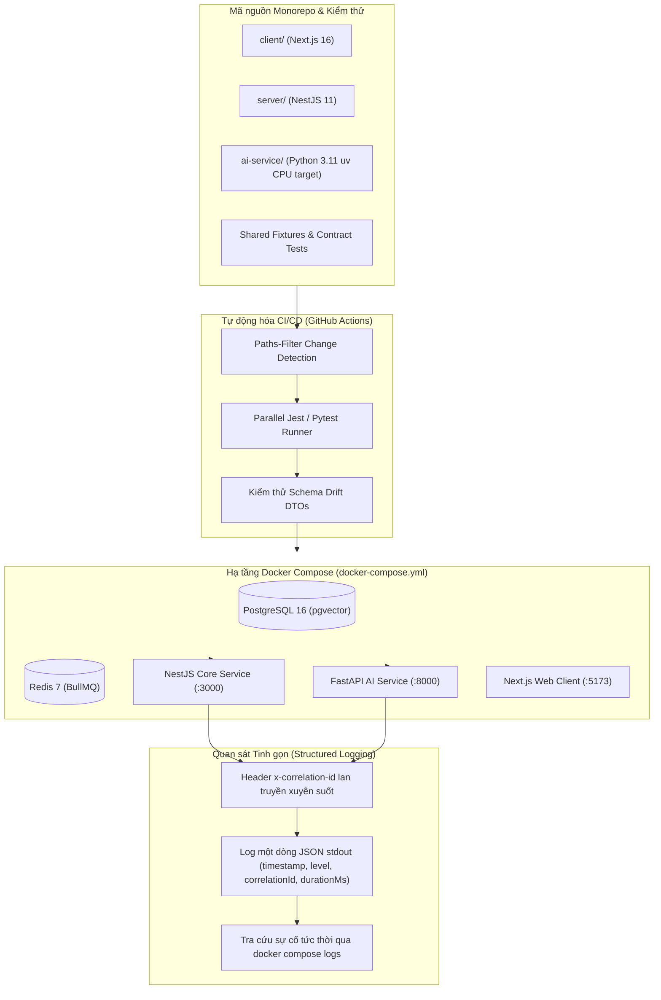

# TÀI LIỆU TỔNG QUAN: PHASE 5 — VẬN HÀNH DEVOPS, TRIỂN KHAI & STRUCTURED LOGGING
# (MASTER OVERVIEW, PRAGMATIC DEVOPS & SRE PIPELINE)

> **Trạng thái**: Approved / Pragmatic Production Specification  
> **Cấp độ**: Production Specification (System Architect / Lead DevOps)  
> **Áp dụng cho**: Toàn bộ Monorepo (`client/`, `server/`, `ai-service/`), Hạ tầng Docker, CI/CD, Logging  
> **Tài liệu tham chiếu**: [00_OVERVIEW_STRATEGIC_BLUEPRINT.md](../00_OVERVIEW_STRATEGIC_BLUEPRINT.md), [05_DEV_OPS_INFRA_AND_DISASTER_RECOVERY.md](../05_DEV_OPS_INFRA_AND_DISASTER_RECOVERY.md)  
> **Phiên bản**: 3.0.0 (Tinh giản thực dụng: Docker Compose 5 dịch vụ, CI GitHub Actions, Structured Logging có correlation-id)  

---

## 1. TỔNG QUAN KIẾN TRÚC VẬN HÀNH PHASE 5

Phase 5 thiết lập nền tảng hạ tầng vận hành ổn định, tinh gọn và thực tế cho toàn bộ hệ sinh thái InterviewCoach:

---

## 2. DANH MỤC CÁC TÀI LIỆU CHUYÊN SÂU TỪNG TASK (TASK BREAKDOWN)

Phase 5 bao gồm 4 nhiệm vụ kỹ thuật thực dụng:

| Thứ tự | Tệp Tài liệu Đặc tả | Trọng tâm Kỹ thuật & Phạm vi Triển khai |
| :---: | :--- | :--- |
| **Task 5.1** | [01_POLYGLOT_MONOREPO_AND_MULTI_STAGE_CONTAINERS.md](01_POLYGLOT_MONOREPO_AND_MULTI_STAGE_CONTAINERS.md) | Đóng gói Multi-stage Dockerfile cho Python (`uv`, target CPU), NestJS Node Alpine, Next.js, và tệp `docker-compose.yml` chuẩn 5 dịch vụ. |
| **Task 5.2** | [02_CI_CD_PIPELINE_AND_AUTOMATED_CONTRACT_TESTS.md](02_CI_CD_PIPELINE_AND_AUTOMATED_CONTRACT_TESTS.md) | GitHub Actions ma trận kiểm thử thông minh (`paths-filter`), tự động chạy Contract Tests chống lệch Schema giữa NestJS DTOs và Python Pydantic Models. |
| **Task 5.3** | [03_STRUCTURED_LOGGING_AND_CORRELATION_ID.md](03_STRUCTURED_LOGGING_AND_CORRELATION_ID.md) | Chuẩn hóa Structured JSON Logging, lan truyền header `x-correlation-id` xuyên suốt Client $\to$ NestJS $\to$ BullMQ $\to$ Python FastAPI, tra cứu sự cố tức thời. |
| **Task 5.4** | [05_ZERO_DOWNTIME_DEPLOYMENT_AND_ROLLBACK_STRATEGY.md](05_ZERO_DOWNTIME_DEPLOYMENT_AND_ROLLBACK_STRATEGY.md) | Kỹ thuật migration CSDL an toàn không khóa bảng (`CREATE INDEX CONCURRENTLY`), cơ chế Circuit Breaker tự ngắt và chuyển sang Cloud Fallback qua biến môi trường. |

---

## 3. CHỈ TIÊU NGHIỆM THU TỔNG THỂ (QUALITY GATE 5)

1. **Khởi Động Nhanh & Nhẹ**: Khởi chạy toàn bộ hệ thống bằng `docker compose up -d` thành công trên máy tính phát triển thông thường (không đòi hỏi card đồ họa rời GPU).
2. **Kháng Lệch Hợp Đồng Tuyệt Đối**: 100% Pull Request thay đổi DTO/Schema đều phải vượt qua bộ kiểm thử Contract Tests trong GitHub Actions.
3. **Khả Năng Truy Vết Toàn Trình**: Mọi request đều có `correlationId` gắn liền trong log, cho phép lọc và tái hiện hành trình xử lý sự cố trong $< 1\text{ phút}$.
4. **Thời Gian Phục Hồi (MTTR)**: Khi Python AI Service gặp sự cố hoặc timeout, hệ thống tự động chuyển sang OpenAI Cloud Fallback trong $< 1\text{s}$ mà không làm gián đoạn phiên phỏng vấn của thí sinh.
