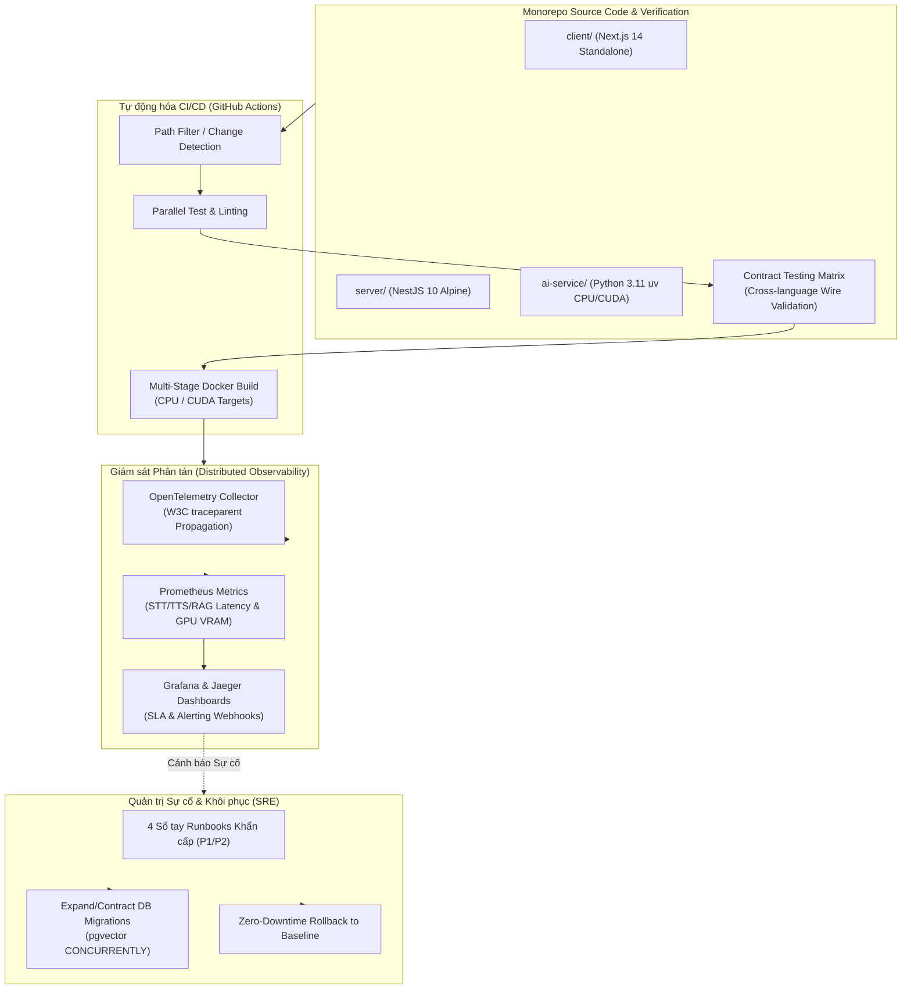

# TÀI LIỆU TỔNG QUAN: PHASE 5 — VẬN HÀNH DEVOPS, QUAN SÁT PHÂN TÁN & QUẢN TRỊ SỰ CỐ
# (MASTER OVERVIEW, SRE ARCHITECTURE & DETAILED TASK EXECUTION PIPELINE)

> **Trạng thái**: Approved / Production Specification  
> **Cấp độ**: Production Specification (System Architect / Lead SRE)  
> **Áp dụng cho**: Toàn bộ Monorepo (`client/`, `server/`, `ai-service/`), Hạ tầng Docker, OpenTelemetry, CI/CD, SRE  
> **Tài liệu tham chiếu**: [00_OVERVIEW_STRATEGIC_BLUEPRINT.md](../00_OVERVIEW_STRATEGIC_BLUEPRINT.md), [05_DEV_OPS_INFRA_AND_DISASTER_RECOVERY.md](../05_DEV_OPS_INFRA_AND_DISASTER_RECOVERY.md)  
> **Phiên bản**: 2.1.0 (Chuẩn hóa toàn diện chuỗi thực thi tuần tự & Thuật ngữ tiếng Anh kỹ thuật)  

---

## 1. TỔNG QUAN KIẾN TRÚC VẬN HÀNH PHASE 5 (SRE & DEVOPS ARCHITECTURE)

Phase 5 thiết lập nền tảng hạ tầng vận hành (DevOps & Site Reliability Engineering - SRE) cấp doanh nghiệp cho InterviewAI. Khi hệ thống phát triển thành kiến trúc đa ngôn ngữ (**Polyglot Monorepo**: Next.js + NestJS + Python FastAPI/FastStream + PostgreSQL pgvector + Redis BullMQ + vLLM GPU Server), việc đảm bảo **tính ổn định cao (High Availability $\ge 99.9\%$), truy vết phân tán xuyên suốt các dịch vụ, và năng lực tự phục hồi khi có sự cố** là điều kiện tiên quyết.



### Các Trụ cột Kiến trúc Vận hành:
1. **Multi-Stage Containerization & uv Acceleration**: Giảm kích thước Docker Image xuống mức tối thiểu (Alpine cho Node.js, `uv` cho Python), tách riêng 2 build target `cpu` (phục vụ CI/Local Dev) và `cuda` (phục vụ GPU Production).
2. **Path-Based CI/CD Matrix & Automated Contract Tests**: Ngăn chặn lãng phí tài nguyên CI bằng `paths-filter`, bắt buộc chạy Contract Verification Suite để tiêu diệt nguy cơ Schema Drift trước khi merge PR.
3. **End-to-End Distributed Observability & Agent Tracing**: Lan truyền W3C `traceparent` qua HTTP REST, WebSocket Binary Stream và Redis BullMQ Outbox Jobs; truy vết chi tiết từng Node trong LangGraph StateGraph, giám sát Tool latencies/errors và hạch toán Token Accounting; tích hợp Prometheus Metrics khống chế Cardinality và Alertmanager cảnh báo tức thời.
4. **P1/P2 Incident Runbooks & BullMQ Unstall**: Sổ tay xử lý sự cố chuẩn hóa với câu lệnh CLI copy-paste chạy ngay, đảm bảo MTTR $< 2\text{ phút}$.
5. **Zero-Downtime Migrations & Baseline Rollback**: Triển khai Non-blocking Indexing (`CREATE INDEX CONCURRENTLY` ngoài Transaction block) theo mô hình Expand/Contract và quy trình Rollback khẩn cấp về thuần NestJS bảo toàn $100\%$ dữ liệu lịch sử.

---

## 2. CHUỖI THỰC THI TUẦN TỰ & VAI TRÒ BOOTSTRAP XUYÊN SUỐT (EXECUTION PIPELINE & BOOTSTRAP ROLE)

### 2.1 Đóng góp Bootstrap Hạ tầng Cho Các Phase Trước (Cross-Phase Bootstrap Role)
Mặc dù Phase 5 nằm ở cuối lộ trình triển khai tính năng nghiệp vụ, nhưng **Task 5.1** và **Task 5.2** đóng vai trò cung cấp hạ tầng mẫu (Bootstrap Templates) được tham chiếu ngay từ các Phase đầu:
* **Task 5.1 (Docker Multi-Stage & Compose)**: Cung cấp mẫu cấu hình đa container chuẩn (`docker-compose.yml`, Dockerfile cho Python và NestJS) làm môi trường thực thi cho Tier 2 Live Integration Tests trong Task 1.1, Task 2.1, Task 3.5, và Task 4.1.
* **Task 5.2 (Contract Test Suite & CI Matrix)**: Cung cấp runner kiểm thử schema hợp đồng và cấu trúc thư mục chia sẻ `contracts/fixtures/` phục vụ cho Task 1.4 (Audio Contract Specs) và Task 2.5 (RAG Allocation Contract Specs).

### 2.2 Luồng Thực thi Tuần tự Bên trong Phase 5 (Sequential Task Flow)
Khi tiến hành hoàn thiện hạ tầng DevOps cho Production, AI Agent bắt buộc thực thi tuần tự theo đúng 5 bước không nhảy cóc:

```
Task 5.1 (Polyglot Docker Multi-Stage)
   │
   ▼
Task 5.2 (CI/CD GitHub Actions & Automated Contract Tests)
   │
   ▼
Task 5.3 (Distributed Observability OpenTelemetry & Prometheus)
   │
   ▼
Task 5.4 (Disaster Recovery P1/P2 Runbooks & Circuit Breakers)
   │
   ▼
Task 5.5 (Zero-Downtime Expand/Contract & Emergency Rollback)
   │
   ▼
[QUALITY GATE 5: PRODUCTION READINESS]
```

---

## 3. DANH MỤC CÁC TÀI LIỆU ĐẶC TẢ CHI TIẾT THEO TASK (TASK BREAKDOWN DIRECTORY)

| Thứ tự | Tệp Tài liệu Đặc tả | Trọng tâm Kỹ thuật & Phạm vi Triển khai | Điều kiện Tiên quyết | Verification Command |
| :---: | :--- | :--- | :--- | :--- |
| **Task 5.1** | [01_POLYGLOT_MONOREPO_AND_MULTI_STAGE_CONTAINERS.md](01_POLYGLOT_MONOREPO_AND_MULTI_STAGE_CONTAINERS.md) | Đóng gói Multi-stage Dockerfile cho Python (`uv`, CPU/CUDA), NestJS `node:alpine`, Next.js `standalone`, tệp `docker-compose.yml` chuẩn hóa và quản lý `.env`. | Hoàn thành Phase 1-4 | `docker compose build`<br/>`docker compose up -d` |
| **Task 5.2** | [02_CI_CD_PIPELINE_AND_AUTOMATED_CONTRACT_TESTS.md](02_CI_CD_PIPELINE_AND_AUTOMATED_CONTRACT_TESTS.md) | GitHub Actions ma trận kiểm thử thông minh (`paths-filter`), tự động chạy Contract Tests chống lệch Schema giữa NestJS DTOs và Python Pydantic Models trước khi merge PR. | Hoàn thành Task 5.1 | `npm run test:contracts`<br/>`pytest tests/test_contracts.py` |
| **Task 5.3** | [03_DISTRIBUTED_OBSERVABILITY_OPENTELEMETRY_PROMETHEUS.md](03_DISTRIBUTED_OBSERVABILITY_OPENTELEMETRY_PROMETHEUS.md) | Truy vết phân tán qua OpenTelemetry chuẩn W3C `traceparent` (Next.js $\to$ NestJS $\to$ ai-service), bóc tách LangGraph Spans, giám sát Tool Latency/Errors, hạch toán Token Accounting, xuất bản Prometheus metrics và Grafana SLA Dashboards. | Hoàn thành Task 5.2 | `curl http://localhost:4000/metrics`<br/>Jaeger trace check |
| **Task 5.4** | [04_DISASTER_RECOVERY_RUNBOOKS_AND_CIRCUIT_BREAKERS.md](04_DISASTER_RECOVERY_RUNBOOKS_AND_CIRCUIT_BREAKERS.md) | 4 Sổ tay ứng phó sự cố sản xuất (Runbooks P1/P2): Sập AI Service, CUDA OOM, Treo/chậm HNSW pgvector, Tràn bộ nhớ Redis, cùng cơ chế Circuit Breaker tự chuyển đổi sang Cloud API trong $< 1$ phút. | Hoàn thành Task 5.3 | Chaos injection test<br/>`npm run job:unstall` |
| **Task 5.5** | [05_ZERO_DOWNTIME_DEPLOYMENT_AND_ROLLBACK_STRATEGY.md](05_ZERO_DOWNTIME_DEPLOYMENT_AND_ROLLBACK_STRATEGY.md) | Chiến lược triển khai Zero-Downtime (Rolling Update), kỹ thuật di chuyển CSDL an toàn (Expand/Contract pattern không khóa bảng cho pgvector `CONCURRENTLY`), và kịch bản Rollback khẩn cấp về baseline NestJS. | Hoàn thành Task 5.4 | `npx prisma migrate deploy`<br/>Rollback simulation |

---

## 4. TIÊU CHÍ NGHIỆM THU TỔNG THỂ PHASE 5 (QUALITY GATE 5)

Để nghiệm thu toàn bộ Phase 5 và xác nhận hệ thống hoàn toàn sẵn sàng cho Production, tất cả các điều kiện sau đây bắt buộc phải được đáp ứng:

1. **High Availability Vận hành**: Mức độ sẵn sàng vận hành của toàn bộ hệ sinh thái dịch vụ đạt $\ge 99.9\%$.
2. **Kháng Lệch Hợp Đồng Tuyệt Đối (Zero Schema Drift)**: $100\%$ các Pull Request thay đổi DTO/Schema đều vượt qua ma trận kiểm thử Contract Verification Suite tự động trong CI pipeline trước khi cho phép merge.
3. **Truy Vết Phân Tán & Agent Observability Toàn Vẹn**: $100\%$ các tác vụ chạy ngầm trong BullMQ Outbox Queue, các bước LangGraph StateGraph và các kết nối WebSocket đều liên kết thành công về Trace ID gốc trên Jaeger; $100\%$ token tiêu thụ được hạch toán minh bạch.
4. **Thời Gian Phục Hồi Sự Cố Tối Ưu (MTTR)**: Toàn bộ quá trình chuyển mạch sang Cloud Fallback khi Python AI sập diễn ra trong $< 2\text{ phút}$, không làm mất dữ liệu hoặc gián đoạn phiên phỏng vấn của thí sinh.
5. **Zero-Downtime Migration & Rollback**: Quá trình tạo index pgvector HNSW trên bảng cơ sở dữ liệu không làm tăng thời gian phản hồi p99 latency quá $50\text{ ms}$; quy trình Rollback khẩn cấp về baseline NestJS hoàn tất trong $< 3\text{ phút}$.
