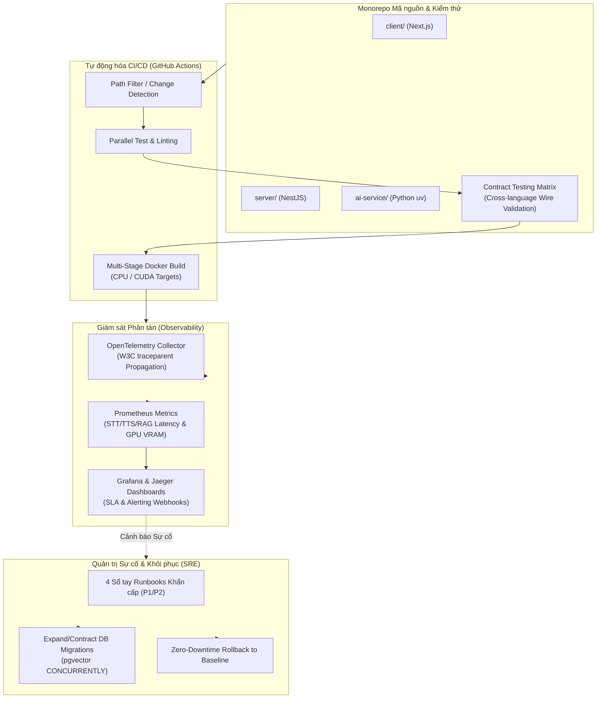

# TÀI LIỆU TỔNG QUAN: PHASE 5 — VẬN HÀNH DEVOPS, QUAN SÁT PHÂN TÁN & QUẢN TRỊ SỰ CỐ
# (MASTER OVERVIEW, ROADMAP & DETAILED TASK BREAKDOWN)

> **Trạng thái**: Approved / Production Specification  
> **Áp dụng cho**: Toàn bộ Monorepo (`client/`, `server/`, `ai-service/`), Hạ tầng Docker, OpenTelemetry, CI/CD, SRE  
> **Tài liệu tham chiếu**: [00_OVERVIEW_STRATEGIC_BLUEPRINT.md](../00_OVERVIEW_STRATEGIC_BLUEPRINT.md), [01_PHASE_1_AUDIO_ENGINE_AND_PILOT.md](../01_PHASE_1_AUDIO_ENGINE_AND_PILOT.md)  
> **Phiên bản**: 2.0.0 (Đã phân rã thành bộ tài liệu chuyên sâu 5 tasks)  

---

## 1. TỔNG QUAN KIẾN TRÚC PHASE 5

Phase 5 thiết lập nền tảng hạ tầng vận hành (DevOps & Site Reliability Engineering - SRE) cấp doanh nghiệp cho InterviewAI. Khi hệ thống phát triển thành kiến trúc đa ngôn ngữ (Polyglot Monorepo: Next.js + NestJS + Python FastStream/vLLM + PostgreSQL pgvector + Redis BullMQ), việc đảm bảo **tính ổn định cao (High Availability $\ge 99.9\%$), truy vết lỗi phân tán, và khả năng tự hồi phục khi có sự cố** là điều kiện tiên quyết.

---

## 2. DANH MỤC CÁC TÀI LIỆU CHUYÊN SÂU TỪNG TASK (TASK BREAKDOWN)

Phase 5 được phân rã thành 5 nhiệm vụ kỹ thuật độc lập với tài liệu đặc tả thực thi riêng biệt:

| Thứ tự | Tệp Tài liệu Đặc tả | Trọng tâm Kỹ thuật & Phạm vi Triển khai |
| :---: | :--- | :--- |
| **Task 5.1** | [01_POLYGLOT_MONOREPO_AND_MULTI_STAGE_CONTAINERS.md](01_POLYGLOT_MONOREPO_AND_MULTI_STAGE_CONTAINERS.md) | Đóng gói Multi-stage Dockerfile cho Python (với công cụ `uv` hỗ trợ 2 target CPU/CUDA), NestJS node:alpine, Next.js standalone, tệp `docker-compose` chuẩn hóa và quản lý biến môi trường. |
| **Task 5.2** | [02_CI_CD_PIPELINE_AND_AUTOMATED_CONTRACT_TESTS.md](02_CI_CD_PIPELINE_AND_AUTOMATED_CONTRACT_TESTS.md) | GitHub Actions ma trận kiểm thử thông minh (Path-based filtering), tự động chạy Contract Tests chống lệch Schema giữa NestJS TypeScript DTOs và Python Pydantic Models trước khi merge PR. |
| **Task 5.3** | [03_DISTRIBUTED_OBSERVABILITY_OPENTELEMETRY_PROMETHEUS.md](03_DISTRIBUTED_OBSERVABILITY_OPENTELEMETRY_PROMETHEUS.md) | Truy vết phân tán qua OpenTelemetry với chuẩn W3C `traceparent` (Next.js $\to$ NestJS $\to$ ai-service), xuất bản các chỉ số Prometheus đo đạc độ trễ AI, VRAM GPU và bảng điều khiển Grafana. |
| **Task 5.4** | [04_DISASTER_RECOVERY_RUNBOOKS_AND_CIRCUIT_BREAKERS.md](04_DISASTER_RECOVERY_RUNBOOKS_AND_CIRCUIT_BREAKERS.md) | 4 Sổ tay ứng phó sự cố sản xuất (Runbooks P1/P2): Sập AI Service, CUDA OOM, Treo/chậm HNSW pgvector, Tràn bộ nhớ Redis, cùng cơ chế Circuit Breaker tự chuyển đổi sang Cloud API trong $< 1$ phút. |
| **Task 5.5** | [05_ZERO_DOWNTIME_DEPLOYMENT_AND_ROLLBACK_STRATEGY.md](05_ZERO_DOWNTIME_DEPLOYMENT_AND_ROLLBACK_STRATEGY.md) | Chiến lược triển khai Zero-Downtime (Rolling Update), kỹ thuật di chuyển CSDL an toàn (Expand/Contract pattern không khóa bảng cho pgvector `CONCURRENTLY`), và kịch bản Rollback khẩn cấp về baseline NestJS. |

---

## 3. LỘ TRÌNH TRIỂN KHAI & TIÊU CHÍ NGHIỆM THU TỔNG THỂ

1. **Tuần 1 (Containerization & CI/CD Pipeline)**: Hoàn tất Task 5.1 và Task 5.2. Toàn bộ monorepo có thể khởi chạy cục bộ qua `docker compose up`, và mọi PR đều được kiểm tra Contract Testing tự động.
2. **Tuần 2 (Observability & Monitoring)**: Hoàn tất Task 5.3. Mọi request phỏng vấn đều có Trace ID đồng nhất xuyên suốt 3 dịch vụ và hiển thị đầy đủ biểu đồ p50/p95/p99 latency.
3. **Tuần 3 (SRE Runbooks & Disaster Recovery Drills)**: Hoàn tất Task 5.4 và Task 5.5. Diễn tập thực tế kịch bản sập giả định (Chaos Engineering): Kill container AI service, đo thời gian chuyển sang OpenAI API đạt chuẩn $< 60\text{ giây}$.
