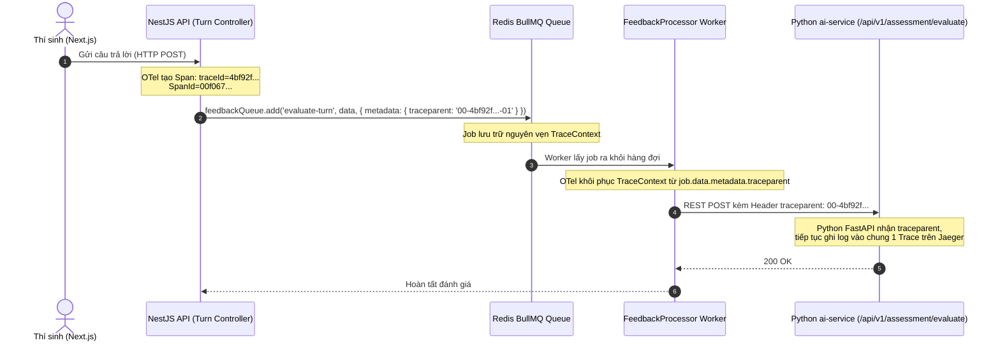

# TASK 5.3: QUAN SÁT PHÂN TÁN OPENTELEMETRY, PROMETHEUS METRICS & SLA ALERTING
# (DISTRIBUTED TRACING W3C TRACEPARENT, HIGH-CARDINALITY GUARDRAILS & GRAFANA SLA DASHBOARD)

> **Trạng thái**: Approved / Production Specification  
> **Cấp độ**: Deep Technical Specification (Distributed Observability & SRE Metrics)  
> **Áp dụng cho**: `server/src/infrastructure/telemetry/`, `ai-service/app/core/telemetry.py`, OpenTelemetry SDK, Prometheus, Grafana  
> **Tài liệu cha**: [00_PHASE_5_OVERVIEW_AND_ARCHITECTURE.md](00_PHASE_5_OVERVIEW_AND_ARCHITECTURE.md)  
> **Phiên bản**: 2.1.0 (Chuẩn hóa toàn diện chuỗi thực thi tuần tự & Thuật ngữ tiếng Anh kỹ thuật)  

---

## 1. PHÂN TÍCH THIẾT KẾ CŨ & NHỮNG ĐIỂM CHƯA CHẶT CHẼ CẦN KHẮC PHỤC

Bản thiết kế hệ thống quan sát ban đầu còn tồn tại **3 lỗ hổng cấu trúc nguy hiểm**:

1. **Gãy Dấu Vết Truy Vết (Trace Disconnection) qua WebSocket và Hàng đợi BullMQ**:
   * OpenTelemetry tự động gắn W3C header `traceparent` cho các cuộc gọi HTTP REST, nhưng khi hệ thống chuyển sang **WebSocket Binary Stream** hoặc đẩy tác vụ chấm điểm vào **Redis BullMQ Outbox**, ngữ cảnh Trace ID bị biến mất.
   * *Hậu quả*: Kỹ sư không thể liên kết giữa hành động thí sinh bấm nộp bài trên giao diện với quá trình Worker chạy đánh giá ở backend.
   * *Giải pháp khắc phục*: Bắt buộc đóng gói `traceparent` vào metadata của Job BullMQ và bản tin bắt tay ban đầu của WebSocket kết nối.
2. **Hiểm Họa Nổ Số Lượng Chuỗi Thời Gian (High Cardinality Explosion) trên Prometheus**:
   * Nếu kỹ sư vô tình đưa `userId`, `sessionId` hoặc `questionBankId` vào label của metric, Prometheus sẽ sinh ra hàng triệu chuỗi thời gian (time-series), làm cạn kiệt RAM của máy chủ giám sát.
   * *Giải pháp khắc phục*: Thiết lập quy tắc khống chế nhãn (Label Whitelisting): Chỉ sử dụng các nhãn có tập giá trị hữu hạn cố định (`provider`, `model`, `status_code`, `stage`, `skill_code`).
3. **Thiếu Bộ Quy Tắc Cảnh Báo SLO/SLA Chủ Động (Proactive Alerting)**:
   * Chỉ vẽ đồ thị mà không thiết lập ngưỡng tự động gửi cảnh báo khẩn cấp (Alertmanager) khi hệ thống tiệm cận sự cố.

---

## 2. TRUY VẾT PHÂN TÁN XUYÊN SUỐT HÀNG ĐỢI BULLMQ & WEBSOCKET

Cơ chế lan truyền ngữ cảnh (Context Propagation) đảm bảo một Trace ID duy nhất bao quát toàn bộ vòng đời của một câu trả lời:



---

## 3. CHUẨN HÓA BỘ CHỈ SỐ PROMETHEUS (PROMETHEUS METRICS SPECIFICATION)

### Bảng Danh Mục Metrics Cốt Lõi:

| Metric Name | Loại | Labels Cho Phép | Mục Đích Đo Lường |
| :--- | :---: | :--- | :--- |
| `interview_ai_stt_duration_seconds` | Histogram | `provider` (`python`, `openai`), `language` | Thời gian xử lý nhận diện giọng nói (Buckets: 0.2, 0.5, 1.0, 2.0, 5.0s). |
| `interview_ai_tts_first_chunk_latency_seconds` | Histogram | `provider` (`python`, `elevenlabs`) | Độ trễ trả về chunk âm thanh đầu tiên (Buckets: 0.1, 0.2, 0.4, 0.8, 1.5s). |
| `interview_ai_rag_duration_seconds` | Histogram | `stage` (`hybrid_sql`, `reranker`, `total`) | Thời gian tìm kiếm và xếp hạng câu hỏi (Buckets: 0.05, 0.1, 0.2, 0.5, 1.0s). |
| `interview_ai_circuit_breaker_state` | Gauge | `target_service` (`vllm_local`, `ai_service`) | Trạng thái Circuit Breaker ($0=\text{CLOSED}, 1=\text{HALF-OPEN}, 2=\text{OPEN}$). |
| `interview_ai_gpu_vram_usage_bytes` | Gauge | `gpu_id` (`0`, `1`) | Bộ nhớ VRAM đang được sử dụng trên card đồ họa. |

---

## 4. QUY TẮC CẢNH BÁO TỰ ĐỘNG (PROMETHEUS ALERT RULES)

Tệp cấu hình cảnh báo `prometheus/alerts.yml`:

```yaml
groups:
  - name: interview_ai_production_alerts
    rules:
      # 1. Cảnh báo Circuit Breaker Mở (Sự cố vLLM)
      - alert: VLLMCircuitBreakerOpen
        expr: interview_ai_circuit_breaker_state{target_service="vllm_local"} == 2
        for: 1m
        labels:
          severity: critical
        annotations:
          summary: "Cảnh báo khẩn cấp: vLLM Circuit Breaker đã MỞ (Diverting to Cloud)"
          description: "Cụm GPU vLLM đang bị lỗi hoặc quá tải liên tục. Toàn bộ traffic đang đổ về OpenAI Cloud."

      # 2. Cảnh báo Độ Trễ STT Tăng Cao (Vi phạm SLA)
      - alert: STTLatencyExceededSLA
        expr: histogram_quantile(0.95, sum(rate(interview_ai_stt_duration_seconds_bucket[5m])) by (le)) > 2.0
        for: 3m
        labels:
          severity: warning
        annotations:
          summary: "Cảnh báo độ trễ STT P95 vượt ngưỡng 2.0s"
          description: "Ứng viên đang phải chờ quá 2 giây để nhận diện giọng nói. Kiểm tra tải CPU/GPU của ai-service."

      # 3. Cảnh báo Nguy Cơ Tràn VRAM GPU
      - alert: GPUVRAMNearExhaustion
        expr: (interview_ai_gpu_vram_usage_bytes / 25769803776) > 0.95
        for: 2m
        labels:
          severity: critical
        annotations:
          summary: "VRAM GPU đạt trên 95%"
          description: "Bộ nhớ VRAM sắp cạn kiệt, nguy cơ sập CUDA OOM trong vòng vài phút!"
```

---

## 5. TASK EXECUTION CONTRACT

### 5.1 Prerequisites (Điều kiện tiên quyết)
* Hoàn thành **Task 5.2** (CI/CD Pipeline hoạt động ổn định).
* Cài đặt các gói OpenTelemetry SDK:
  * Trong `server/`: `@opentelemetry/sdk-node`, `@opentelemetry/auto-instrumentations-node`, `prom-client`.
  * Trong `ai-service/`: `opentelemetry-api`, `opentelemetry-sdk`, `opentelemetry-instrumentation-fastapi`, `prometheus-fastapi-instrumentator`.
* Máy chủ Prometheus và Jaeger đang chạy cục bộ hoặc qua Docker Compose.

### 5.2 Target Deliverables (Sản phẩm bàn giao)
* `server/src/infrastructure/telemetry/telemetry.module.ts`: Module khởi tạo OpenTelemetry SDK, export `/metrics` endpoint cho Prometheus.
* `server/src/infrastructure/telemetry/bullmq-telemetry.interceptor.ts`: Tự động tiêm và trích xuất W3C `traceparent` cho các BullMQ Jobs.
* `ai-service/app/core/telemetry.py`: FastAPI middleware trích xuất W3C TraceContext và tích hợp Prometheus metrics exporter.
* `prometheus/alerts.yml`: Bộ quy tắc cảnh báo cho Circuit Breaker, p95 Latency và VRAM GPU.
* `grafana/dashboards/interview_ai_sla.json`: Dashboard hiển thị p50/p95/p99 latency và Circuit Breaker state.

### 5.3 Verification Commands (Lệnh kiểm thử xác thực)
* **Tier 1 (Kiểm tra Cú pháp Cảnh báo & Metric Endpoint)**:
  ```bash
  # 1. Kiểm tra tính hợp lệ của Alert Rules
  promtool check rules prometheus/alerts.yml

  # 2. Kiểm tra Prometheus metrics endpoint của NestJS
  curl -s http://localhost:4000/metrics | grep "interview_ai_"
  ```
* **Tier 2 (Xác thực Truy vết Phân tán End-to-End Tracing)**:
  ```bash
  # Gửi 1 câu trả lời mẫu qua API
  curl -X POST http://localhost:4000/api/v1/interviews/sessions/sess_test/turns \
    -H "Content-Type: application/json" \
    -d '{"questionId": "q_1", "transcript": "Testing tracing"}'

  # Truy vấn Jaeger API để xác nhận Trace ID xuyên suốt NestJS -> BullMQ -> Python ai-service
  curl -s "http://localhost:16686/api/traces?service=interviewai-backend&limit=1" | grep -q "spans" && echo "DISTRIBUTED TRACE VERIFIED"
  ```

### 5.4 Definition of Done [DoD]
* [ ] **Tính Toàn Vẹn Của Trace ID (End-to-End Tracing)**: $100\%$ các tác vụ chấm điểm trong BullMQ đều truy vết ngược thành công về Trace ID của HTTP request khởi tạo ban đầu trên giao diện Jaeger.
* [ ] **Khống Chế Cardinality**: Số lượng timeseries của nhóm metric `interview_ai_*` không vượt quá 500 chuỗi trên toàn hệ thống Prometheus; không chứa các trường động như `userId` hay `sessionId`.
* [ ] **Phát Hiện Sự Cố Chủ Động**: Khi container AI bị treo hoặc trả lỗi liên tục, Alertmanager kích hoạt alert trong vòng $< 60\text{ giây}$.

### 5.5 Next Task Transition (Chuyển tiếp Nhiệm vụ)
* Sau khi hệ thống quan sát phân tán và các chỉ số đo lường độ trễ đã vận hành chính xác, chuyển giao sang **Task 5.4** ([04_DISASTER_RECOVERY_RUNBOOKS_AND_CIRCUIT_BREAKERS.md](04_DISASTER_RECOVERY_RUNBOOKS_AND_CIRCUIT_BREAKERS.md)) để chuẩn hóa 4 bộ Runbook ứng phó sự cố sản xuất P1/P2 và cơ chế giải phóng hàng đợi BullMQ kẹt.
