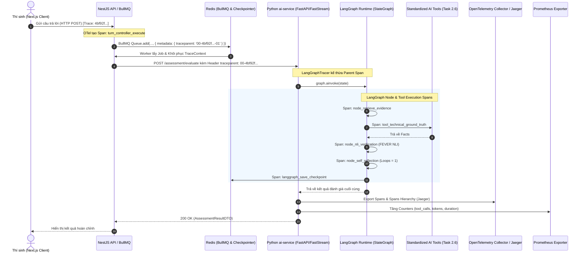

# TASK 5.3: QUAN SÁT PHÂN TÁN OPENTELEMETRY, AGENT OBSERVABILITY & PROMETHEUS SLA ALERTING
# (DISTRIBUTED TRACING W3C TRACEPARENT, LANGGRAPH SPAN INSTRUMENTATION, AGENT TOOL METRICS & TOKEN ACCOUNTING)

> **Trạng thái**: Approved / Production Specification  
> **Cấp độ**: Deep Technical Specification (Distributed Observability & SRE Metrics)  
> **Áp dụng cho**: `server/src/infrastructure/telemetry/`, `ai-service/app/core/telemetry.py`, `ai-service/app/core/agent_tracer.py`, OpenTelemetry SDK, Prometheus, Grafana  
> **Tài liệu cha**: [00_PHASE_5_OVERVIEW_AND_ARCHITECTURE.md](00_PHASE_5_OVERVIEW_AND_ARCHITECTURE.md)  
> **Phiên bản**: 2.2.0 (Bổ sung toàn diện LangGraph StateGraph Tracing, Tool Metrics & Token Accounting)  

---

## 1. PHÂN TÍCH HIỆN TRẠNG & CƠ SỞ LÝ THUYẾT

### 1.1 Khủng Hoảng Hộp Đen Trong Hệ Thống Multi-Agent (The Multi-Agent Black-Box Dilemma)
Khi hệ thống chuyển đổi từ pipeline nguyên khối sang **Agentic RAG** (LangGraph StateGraph ở Task 2.7, Task 3.2B và Fast-Path ở Task 4.5), độ phức tạp trong việc gỡ lỗi tăng vọt theo cấp số nhân:
* **Mất dấu vết vòng lặp nội tại**: Một Agent có thể thực hiện nhiều lượt suy luận (multi-hop retrieval), gọi 3 công cụ khác nhau (`QuestionBankRetrieverTool`, `CompetencyTaxonomyTool`, `TechnicalGroundTruthTool`), và kích hoạt 2 vòng lặp phản tư (Self-Reflection loops). Nếu chỉ đo thời gian phản hồi HTTP tổng, kỹ sư hoàn toàn không biết Agent bị tắc nghẽn ở bước nào hay công cụ nào trả về rác.
* **Mất dấu vết qua ranh giới dịch vụ (Trace Disconnection)**: OpenTelemetry tự động gắn W3C header `traceparent` cho các cuộc gọi HTTP REST, nhưng khi tác vụ đi qua **WebSocket Binary Stream** (WebRTC Live) hoặc hàng đợi **Redis BullMQ Outbox**, ngữ cảnh Trace ID bị đứt đoạn.
* **Rủi ro Chi phí & Nổ Cardinality (Token Drift & Metric Cardinality)**:
  - Nếu kỹ sư vô tình đưa `userId`, `sessionId` hoặc `questionBankId` vào label của Prometheus metric, hệ thống sẽ sinh ra hàng triệu chuỗi thời gian (time-series), làm sập máy chủ giám sát.
  - Thiếu hệ thống hạch toán token (Token Accounting) chi tiết cho từng Node/Agent khiến việc kiểm soát chi phí LLM rơi vào thế bị động.

### 1.2 Nguyên Tắc Thiết Kế Cốt Lõi
1. **W3C TraceContext Propagation Toàn Vẹn**: Lan truyền `traceparent` qua HTTP, WebSocket và BullMQ Jobs. Mọi Span của LangGraph Node và Tool Call đều là Span con (Child Spans) của Trace ID khởi tạo ban đầu.
2. **Khống Chế Cardinality Tuyệt Đối (Strict Label Whitelisting)**: Chỉ cho phép các nhãn có tập giá trị hữu hạn cố định (`agent_name`, `tool_name`, `node_name`, `status`, `provider`, `model`, `token_type`).
3. **Giám Sát Toàn Diện 4 Chiều (4D Agent Observability)**:
   - **Latency Dimension**: Thời gian thực thi từng Node trong StateGraph và độ trễ từng Tool Call.
   - **Quality Dimension**: Tỷ lệ vòng lặp phản tư (Reflection Rate), tỷ lệ thành công của Tool.
   - **Cost Dimension**: Hạch toán Token tiêu thụ (Prompt/Completion) và chi phí ước tính theo từng Agent.
   - **Storage Dimension**: Kích thước Checkpoint trạng thái StateGraph lưu trên Redis.

---

## 2. KIẾN TRÚC GIẢI PHÁP & SƠ ĐỒ LUỒNG (MERMAID)

### 2.1 Sơ Đồ Lan Truyền Ngữ Cảnh Xuyên Suốt Multi-Agent Graph (End-to-End Tracing Flow)



---

## 3. THIẾT KẾ CHI TIẾT & ĐẶC TẢ KỸ THUẬT

### 3.1 LangGraph OpenTelemetry Custom Tracer (`ai-service/`)

```python
# ai-service/app/core/agent_tracer.py
import time
from typing import Any, Dict, Optional
from opentelemetry import trace
from opentelemetry.trace import Status, StatusCode, SpanKind
from prometheus_client import Counter, Histogram

tracer = trace.get_tracer("interview_ai.agent_runtime", "2.2.0")

# --- PROMETHEUS METRICS DEFINITIONS ---
AGENT_TOOL_CALL_TOTAL = Counter(
    "interview_ai_agent_tool_call_total",
    "Tổng số lần gọi AI Tool từ các Agent",
    labelnames=["agent_name", "tool_name", "status"]
)

AGENT_TOOL_DURATION_SECONDS = Histogram(
    "interview_ai_agent_tool_latency_seconds",
    "Độ trễ thực thi của từng AI Tool",
    labelnames=["agent_name", "tool_name"],
    buckets=[0.05, 0.1, 0.25, 0.5, 1.0, 2.5, 5.0]
)

AGENT_GRAPH_DURATION_SECONDS = Histogram(
    "interview_ai_agent_graph_execution_duration_seconds",
    "Thời gian hoàn tất toàn bộ chu trình StateGraph",
    labelnames=["agent_name", "status"],
    buckets=[1.0, 3.0, 5.0, 10.0, 20.0, 30.0]
)

AGENT_REFLECTION_LOOPS_TOTAL = Counter(
    "interview_ai_agent_reflection_loops_total",
    "Số vòng lặp phản tư (Self-Reflection) được kích hoạt",
    labelnames=["agent_name", "loop_outcome"]
)

AGENT_TOKENS_CONSUMED_TOTAL = Counter(
    "interview_ai_agent_tokens_consumed_total",
    "Tổng số token tiêu thụ bởi từng Agent",
    labelnames=["agent_name", "model", "token_type"]
)

class LangGraphTelemetryCallbacks:
    """Callback hook cho LangGraph & BaseTool tự động ghi Spans và Metrics"""
    
    @staticmethod
    def trace_node(agent_name: str, node_name: str):
        def decorator(func):
            async def wrapper(*args, **kwargs):
                with tracer.start_as_current_span(
                    f"langgraph.node.{node_name}",
                    kind=SpanKind.INTERNAL,
                    attributes={
                        "agent.name": agent_name,
                        "langgraph.node": node_name
                    }
                ) as span:
                    try:
                        result = await func(*args, **kwargs)
                        span.set_status(Status(StatusCode.OK))
                        return result
                    except Exception as exc:
                        span.set_status(Status(StatusCode.ERROR, str(exc)))
                        span.record_exception(exc)
                        raise
            return wrapper
        return decorator

    @staticmethod
    def record_tool_call(agent_name: str, tool_name: str, duration: float, success: bool):
        status_str = "success" if success else "error"
        AGENT_TOOL_CALL_TOTAL.labels(agent_name=agent_name, tool_name=tool_name, status=status_str).inc()
        AGENT_TOOL_DURATION_SECONDS.labels(agent_name=agent_name, tool_name=tool_name).observe(duration)

    @staticmethod
    def record_tokens(agent_name: str, model: str, prompt_tokens: int, completion_tokens: int):
        AGENT_TOKENS_CONSUMED_TOTAL.labels(agent_name=agent_name, model=model, token_type="prompt").inc(prompt_tokens)
        AGENT_TOKENS_CONSUMED_TOTAL.labels(agent_name=agent_name, model=model, token_type="completion").inc(completion_tokens)
```

### 3.2 Bảng Danh Mục Metrics Cốt Lõi Trên Prometheus

| Metric Name | Loại | Labels Cho Phép (Whitelisted) | Mục Đích Đo Lường |
| :--- | :---: | :--- | :--- |
| `interview_ai_agent_tool_call_total` | Counter | `agent_name`, `tool_name`, `status` (`success`, `error`) | Tần suất gọi và tỷ lệ lỗi của từng AI Tool. |
| `interview_ai_agent_tool_latency_seconds` | Histogram | `agent_name`, `tool_name` | Thời gian thực thi truy xuất của Tool (Buckets: 0.05s - 5.0s). |
| `interview_ai_agent_graph_execution_duration_seconds` | Histogram | `agent_name`, `status` (`completed`, `timeout`, `failed`) | Thời gian hoàn tất toàn bộ StateGraph (Buckets: 1.0s - 30.0s). |
| `interview_ai_agent_reflection_loops_total` | Counter | `agent_name`, `loop_outcome` (`passed`, `re_retrieved`, `exhausted`) | Tần suất kích hoạt vòng lặp phản tư Self-Reflection. |
| `interview_ai_agent_tokens_consumed_total` | Counter | `agent_name`, `model`, `token_type` (`prompt`, `completion`) | Hạch toán số lượng token phục vụ theo dõi chi phí. |
| `interview_ai_checkpoint_size_bytes` | Histogram | `agent_name` | Kích thước payload State lưu trên Redis Checkpointer. |
| `interview_ai_stt_duration_seconds` | Histogram | `provider`, `language` | Thời gian xử lý nhận diện giọng nói (Phase 1). |
| `interview_ai_tts_first_chunk_latency_seconds` | Histogram | `provider` | Độ trễ trả về chunk âm thanh đầu tiên TTFA (Phase 1/4). |
| `interview_ai_circuit_breaker_state` | Gauge | `target_service` | Trạng thái Circuit Breaker ($0=\text{CLOSED}, 1=\text{HALF-OPEN}, 2=\text{OPEN}$). |

### 3.3 Quy Tắc Cảnh Báo SRE Tự Động (`prometheus/alerts.yml`)

```yaml
groups:
  - name: interview_ai_production_agent_alerts
    rules:
      # 1. Cảnh báo Tỷ lệ Lỗi Tool của Agent Vượt Ngưỡng 5%
      - alert: AgentToolErrorRateHigh
        expr: |
          (
            sum(rate(interview_ai_agent_tool_call_total{status="error"}[5m]))
            /
            sum(rate(interview_ai_agent_tool_call_total[5m]))
          ) > 0.05
        for: 2m
        labels:
          severity: critical
        annotations:
          summary: "Tỷ lệ lỗi AI Tool vượt quá 5%"
          description: "Agent {{ $labels.agent_name }} gặp lỗi liên tục khi gọi {{ $labels.tool_name }}. Cần kiểm tra pgvector hoặc database connectivity."

      # 2. Cảnh báo Thời Gian Chạy StateGraph Vượt Ngưỡng P95 > 20s
      - alert: AgentGraphExecutionLatencyExceededSLA
        expr: |
          histogram_quantile(0.95, sum(rate(interview_ai_agent_graph_execution_duration_seconds_bucket[5m])) by (le, agent_name)) > 20.0
        for: 3m
        labels:
          severity: warning
        annotations:
          summary: "Agent Graph thực thi vượt quá 20 giây"
          description: "Agent {{ $labels.agent_name }} P95 latency vượt ngưỡng 20s. Nguy cơ nghẽn hàng đợi BullMQ."

      # 3. Cảnh báo Bẫy Vòng Lặp Phản Tư Bất Thường (Reflection Loop Trap)
      - alert: AgentExcessiveReflectionLoops
        expr: |
          rate(interview_ai_agent_reflection_loops_total{loop_outcome="exhausted"}[5m]) > 0.5
        for: 2m
        labels:
          severity: warning
        annotations:
          summary: "Agent liên tục cạn kiệt số lượt phản tư (Reflection Exhaustion)"
          description: "Agent {{ $labels.agent_name }} không thể hội tụ bằng chứng sau số lần lặp tối đa. Cần kiểm tra chất lượng Retrieval Corpus."

      # 4. Cảnh báo Circuit Breaker Mở (Diverting to Cloud)
      - alert: VLLMCircuitBreakerOpen
        expr: interview_ai_circuit_breaker_state{target_service="vllm_local"} == 2
        for: 1m
        labels:
          severity: critical
        annotations:
          summary: "vLLM Circuit Breaker đã MỞ (Diverting to Cloud)"
          description: "Cụm GPU vLLM đang bị lỗi hoặc quá tải liên tục. Toàn bộ traffic đang đổ về OpenAI Cloud."
```

---

## 4. TÍCH HỢP HỆ THỐNG & LUỒNG TƯƠNG TÁC

### 4.1 Cơ Chế Trích Xuất & Tiêm W3C TraceContext Trong NestJS BullMQ
File: `server/src/infrastructure/telemetry/bullmq-telemetry.interceptor.ts`

```typescript
import { CallHandler, ExecutionContext, Injectable, NestInterceptor } from '@nestjs/common';
import { Observable } from 'rxjs';
import { trace, context, propagation } from '@opentelemetry/api';

@Injectable()
export class BullMqTelemetryInterceptor implements NestInterceptor {
  intercept(execContext: ExecutionContext, next: CallHandler): Observable<any> {
    const job = execContext.switchToHttp().getRequest(); // Hoặc BullMQ Job context
    
    if (job?.data?.metadata?.traceparent) {
      // Khôi phục Context từ traceparent trong job metadata
      const carrier = { traceparent: job.data.metadata.traceparent };
      const extractedContext = propagation.extract(context.active(), carrier);
      
      return new Observable((subscriber) => {
        context.with(extractedContext, () => {
          const span = trace.getTracer('interview-server').startSpan(`bullmq.process.${job.name}`);
          next.handle().subscribe({
            next: (val) => subscriber.next(val),
            error: (err) => {
              span.recordException(err);
              span.end();
              subscriber.error(err);
            },
            complete: () => {
              span.end();
              subscriber.complete();
            },
          });
        });
      });
    }

    return next.handle();
  }
}
```

---

## 5. TIÊU CHUẨN KIỂM THỬ & ĐẢM BẢO CHẤT LƯỢNG

### 5.1 Kiểm Thử Cú Pháp Alerts & Cardinality Khống Chế
```bash
# 1. Kiểm tra tính hợp lệ của Prometheus Alert Rules
promtool check rules prometheus/alerts.yml

# 2. Kiểm tra giới hạn Cardinality của Prometheus metrics
curl -s http://localhost:4000/metrics | grep -E "userId|sessionId|questionBankId" && echo "VIOLATION: High cardinality labels detected!" || echo "CARDINALITY CHECK PASSED"
```

### 5.2 Kiểm Thử Truy Vết Phân Tán End-to-End Tracing
Kịch bản xác thực tự động:
1. Gửi request tạo curriculum hoặc chấm điểm qua NestJS API.
2. NestJS đẩy BullMQ Job kèm `traceparent`.
3. Worker gửi sang `ai-service/`, LangGraph chạy các Node và Tool.
4. Truy vấn Jaeger REST API kiểm tra cây Span:
   - Root Span: `POST /api/v1/interviews/turns`
   - Child Span 1: `bullmq.process.evaluate-turn`
   - Child Span 2: `langgraph.node.node_retrieve_evidence`
   - Child Span 3: `langgraph.tool.tool_technical_ground_truth`
   - Child Span 4: `langgraph.node.node_nli_verification`

---

## 6. PHÂN TÍCH TÁC ĐỘNG & KẾ HOẠCH TRIỂN KHAI

### 6.1 Tác Động Tài Nguyên Hạ Tầng (Resource Overhead)
* **OpenTelemetry SDK**: Overhead độ trễ $< 2\text{ ms}$ cho mỗi HTTP/gRPC request.
* **Bộ nhớ Prometheus**: Giới hạn nhãn giúp duy trì tổng số timeseries $< 600$ chuỗi cho toàn bộ hệ thống, tiêu tốn $< 150\text{ MB}$ RAM trên Prometheus server.

### 6.2 Target Deliverables (Sản phẩm bàn giao)
* [ ] `server/src/infrastructure/telemetry/telemetry.module.ts`: Khởi tạo OpenTelemetry NodeSDK, exporter `/metrics`.
* [ ] `server/src/infrastructure/telemetry/bullmq-telemetry.interceptor.ts`: Tự động tiêm và trích xuất W3C `traceparent` cho các BullMQ Jobs.
* [ ] `ai-service/app/core/telemetry.py`: FastAPI middleware trích xuất W3C TraceContext và Prometheus metrics.
* [ ] `ai-service/app/core/agent_tracer.py`: Decorator và Callbacks giám sát LangGraph StateGraph, Tool Latency và Token Accounting.
* [ ] `prometheus/alerts.yml`: Bộ quy tắc cảnh báo cho Tool error, Latency SLA, VRAM và Circuit Breaker.
* [ ] `grafana/dashboards/interview_ai_sla.json`: Dashboard theo dõi toàn diện SLAs, Multi-Agent metrics và Token spend.

### 6.3 Verification Commands
```bash
# Tier 1: Cú pháp Alert Rules
promtool check rules prometheus/alerts.yml

# Tier 2: Agent Telemetry Pytest Suite
cd ai-service && pytest tests/unit/test_agent_telemetry.py -v

# Tier 3: Jaeger Trace Inspection
curl -s "http://localhost:16686/api/traces?service=interviewai-backend&limit=1" | grep -q "langgraph.node" && echo "AGENT TRACING VERIFIED"
```

---

## 7. TÀI LIỆU CHUYỂN TIẾP & BƯỚC TIẾP THEO

### 7.1 Definition of Done (DoD)
- [ ] **Tính Toàn Vẹn Của Trace ID (End-to-End Tracing)**: $100\%$ các tác vụ chạy qua LangGraph và BullMQ đều truy vết ngược thành công về Trace ID gốc trên Jaeger UI.
- [ ] **Khống Chế Cardinality**: Số lượng timeseries của nhóm metric `interview_ai_*` không vượt quá 600 chuỗi trên toàn hệ thống Prometheus; không chứa các trường động ID người dùng.
- [ ] **Hạch Toán Token & Chi Phí Minh Bạch**: Mọi tác vụ suy luận của Agent đều ghi nhận chính xác số token tiêu thụ vào `interview_ai_agent_tokens_consumed_total`.
- [ ] **Phát Hiện Sự Cố Chủ Động**: Khi Tool hoặc LLM gặp lỗi liên tục $\ge 5\%$, Alertmanager kích hoạt alert trong vòng $< 120\text{ giây}$.

### 7.2 Next Task Transition (Bước chuyển tiếp)
- Chuyển giao sang **Task 5.4**: [04_DISASTER_RECOVERY_RUNBOOKS_AND_CIRCUIT_BREAKERS.md](04_DISASTER_RECOVERY_RUNBOOKS_AND_CIRCUIT_BREAKERS.md) để chuẩn hóa 4 bộ Runbook ứng phó sự cố sản xuất P1/P2 và cơ chế giải phóng hàng đợi BullMQ kẹt.
