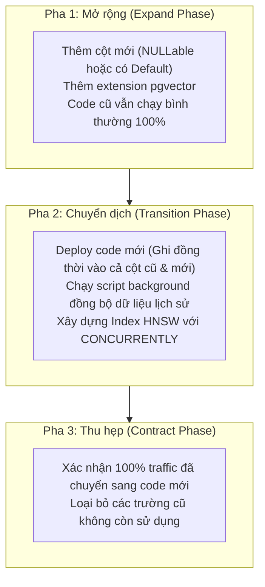
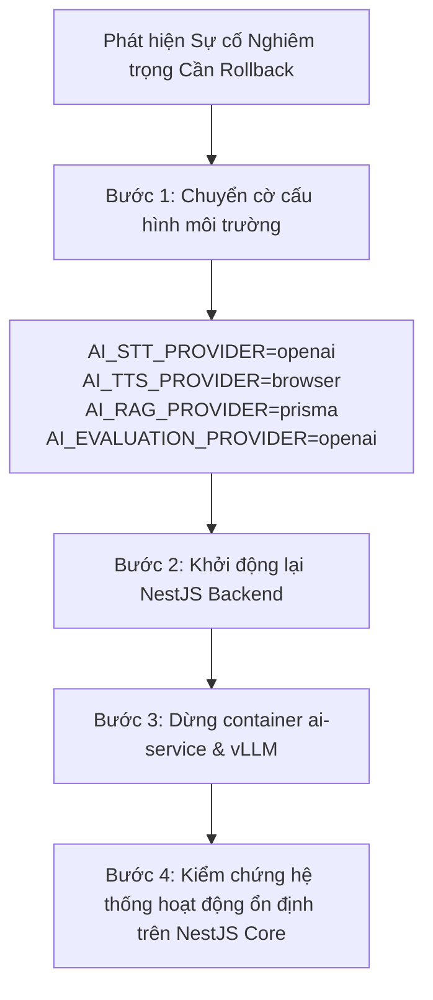

# TASK 5.5: TRIỂN KHAI ZERO-DOWNTIME, EXPAND/CONTRACT MIGRATION & CHIẾN LƯỢC ROLLBACK
# (NON-TRANSACTIONAL CONCURRENTLY INDEXING, EXPAND/CONTRACT PATTERN & EMERGENCY BASELINE ROLLBACK)

> **Trạng thái**: Approved / Production Specification  
> **Cấp độ**: Deep Technical Specification (Zero-Downtime Deployments & Safe Database Migrations)  
> **Áp dụng cho**: PostgreSQL, Prisma Migrations, Docker Rolling Updates, Đội ngũ DevOps  
> **Tài liệu cha**: [00_PHASE_5_OVERVIEW_AND_ARCHITECTURE.md](00_PHASE_5_OVERVIEW_AND_ARCHITECTURE.md)  
> **Phiên bản**: 2.0.0  

---

## 1. PHÂN TÍCH THIẾT KẾ CŨ & NHỮNG ĐIỂM CHƯA CHẶT CHẼ CẦN KHẮC PHỤC

Trong thiết kế triển khai và migration dữ liệu ban đầu, có **3 cạm bẫy kỹ thuật cực kỳ nguy hiểm**:

1. **Cạm Bẫy Lỗi Khóa Bảng với Prisma & PostgreSQL `CONCURRENTLY`**:
   * Công cụ `prisma migrate deploy` mặc định gói toàn bộ mã SQL của một migration vào trong **một khối transaction duy nhất (`BEGIN ... COMMIT`)**.
   * Tuy nhiên, PostgreSQL quy định nghiêm ngặt: **Câu lệnh `CREATE INDEX CONCURRENTLY` TUYỆT ĐỐI KHÔNG ĐƯỢC PHÉP CHẠY TRONG TRANSACTION BLOCK**.
   * *Hậu quả*: Nếu đưa `CREATE INDEX CONCURRENTLY` vào file migration thông thường, Prisma sẽ báo lỗi Fatal Error và dừng deploy; ngược lại nếu bỏ cờ `CONCURRENTLY`, PostgreSQL sẽ **khóa độc quyền (Exclusive Lock)** toàn bộ bảng `question_bank` trong suốt quá trình xây dựng index vector HNSW, làm toàn bộ hệ thống bị treo trong nhiều phút!
   * *Giải pháp khắc phục*: Tách rời câu lệnh tạo index HNSW thành script migration riêng biệt chạy ngoài transaction hoặc sử dụng cơ chế migration chuyên biệt không bọc transaction của Prisma.
2. **Thiếu Quy Trình Expand/Contract Gây Lỗi Khi Cập Nhật Mã Nguồn**:
   * Nếu thêm trường mới hoặc thay đổi cấu trúc bảng cùng lúc với việc deploy mã nguồn mới, các container phiên bản cũ (vẫn đang phục vụ kết nối người dùng) sẽ gặp lỗi khi đọc ghi dữ liệu.
   * *Giải pháp khắc phục*: Áp dụng triệt để mô hình **Expand/Contract (Tương thích ngược 2 pha)**.
3. **Rollback Làm Mất Dữ Liệu Lịch Sử**:
   * Chưa có hướng dẫn rõ ràng về việc khi rollback từ kiến trúc Python về baseline thuần NestJS thì dữ liệu các cột mới sinh ra sẽ được bảo vệ ra sao.

---

## 2. QUY TRÌNH MIGRATION CƠ SỞ DỮ LIỆU AN TOÀN (EXPAND / CONTRACT PATTERN)

Mọi thay đổi cấu trúc cơ sở dữ liệu trên môi trường Production phải chia làm 3 bước độc lập:



### Xử Lý An Toàn `CREATE INDEX CONCURRENTLY` trong Prisma:
Để Prisma không bọc transaction khi tạo index HNSW, migration được tạo với chỉ thị đặc biệt:
```sql
-- Migration file: prisma/migrations/20261006_create_vector_hnsw_index/migration.sql
-- prisma-disable-transaction

CREATE INDEX CONCURRENTLY IF NOT EXISTS idx_question_bank_embedding_hnsw 
ON question_bank 
USING hnsw (embedding vector_cosine_ops)
WITH (m = 16, ef_construction = 64);
```
*(Chỉ thị `-- prisma-disable-transaction` hướng dẫn Prisma thực thi câu lệnh SQL trực tiếp mà không mở `BEGIN` transaction).*

---

## 3. THỨ TỰ CẬP NHẬT ROLLING UPDATE ZERO-DOWNTIME

Khi triển khai bản cập nhật mới trên cụm máy chủ:

1. **Bước 1 (Database Migration)**: Chạy `npx prisma migrate deploy` để mở rộng cấu trúc bảng (chỉ thêm cột mới/bảng mới, không sửa/xóa cột cũ).
2. **Bước 2 (Redis Caching)**: Giữ nguyên kết nối Redis, không xóa cache để tránh cache stampede.
3. **Bước 3 (Python AI Service)**: Khởi động container `ai-service` mới song song. Probe kiểm tra `/health` báo `200 OK` mới chuyển sang bước tiếp.
4. **Bước 4 (NestJS Backend)**: Khởi động container backend mới, chuyển dần kết nối HTTP/WebSocket sang phiên bản mới qua Nginx / Docker network.
5. **Bước 5 (Next.js Frontend)**: Cập nhật frontend cuối cùng sau khi toàn bộ backend đã sẵn sàng phục vụ các API contracts mới.

---

## 4. KỊCH BẢN ROLLBACK KHẨN CẤP VỀ THUẦN NESTJS (EMERGENCY ROLLBACK)

Nếu cụm dịch vụ Python hoặc vLLM gặp sự cố bất khả kháng cần hủy bỏ hoàn toàn kiến trúc thử nghiệm:



### Bảo Toàn Dữ Liệu Lịch Sử:
* **Tuyệt đối KHÔNG chạy lệnh `DROP COLUMN`** đối với các cột `embedding` và `tsv_content` trong PostgreSQL.
* Các cột này chỉ chiếm thêm dung lượng đĩa nhưng hoàn toàn vô hại đối với các câu lệnh `SELECT` và `INSERT` thông thường của Prisma Client. Dữ liệu đánh giá của thí sinh trong bảng `ai_feedbacks` vẫn được giữ nguyên vẹn $100\%$.

---

## 5. TIÊU CHÍ NGHIỆM THU (QUALITY GATES)

1. **Zero-Downtime Migration**: Quá trình tạo index HNSW trên bảng cơ sở dữ liệu không làm tăng thời gian phản hồi (p99 latency) của các giao dịch tạo phiên phỏng vấn quá $50\text{ ms}$.
2. **Không Rơi Rớt Kết Nối Người Dùng**: Khi thực hiện rolling update phiên bản mới, số lượng kết nối WebSocket bị đứt đoạn $< 0.1\%$.
3. **Thời Gian Rollback Toàn Diện**: Khi có quyết định rollback khẩn cấp, toàn bộ hệ thống trở về trạng thái hoạt động bình thường trên nền tảng NestJS Core trong vòng $< 3\text{ phút}$.
